# Kiến trúc ứng dụng RecipeHub Mobile (MVVM + Provider + Firebase)

Tài liệu đặc tả kiến trúc tổng thể, cấu trúc thư mục, sơ đồ lớp MVVM, luồng dữ liệu tuần tự và ma trận ViewModel ↔ Dịch vụ của ứng dụng RecipeHub Mobile.

---

## 1. Cấu trúc thư mục mã nguồn (`lib/`)

Cây thư mục theo quy tắc mỗi dòng một thư mục, phân tách rõ ràng giữa hạ tầng dùng chung (`core`) và các tính năng nghiệp vụ (`features`):

```
lib
├── core
│   ├── bootstrap
│   ├── config
│   ├── dev
│   ├── di
│   ├── models
│   ├── navigation
│   ├── services
│   │   ├── device
│   │   ├── firebase
│   │   ├── interfaces
│   │   ├── mock
│   │   └── report
│   ├── theme
│   ├── utils
│   ├── viewmodels
│   └── widgets
└── features
    ├── account
    ├── admin_training
    ├── auth
    ├── feedback
    ├── learning
    ├── lookup
    ├── practice
    ├── sop
    ├── sop_book
    └── system
```

---

## 2. Mô hình MVVM và Luồng dữ liệu

Ứng dụng tuân thủ nghiêm ngặt mô hình **MVVM (Model - View - ViewModel)** kết hợp với **Provider**:
- **View (`lib/features/*`)**: Chỉ chịu trách nhiệm hiển thị giao diện, nhận tương tác người dùng, lắng nghe trạng thái từ ViewModel (`context.watch`) hoặc gọi phương thức ViewModel (`context.read`). Tuyệt đối không import hoặc gọi trực tiếp SDK Firebase hay SDK nền tảng.
- **ViewModel (`lib/core/viewmodels/*`)**: Kế thừa `ChangeNotifier`, quản lý toàn bộ trạng thái UI (loading, ready, empty, error), xử lý logic nghiệp vụ và giao tiếp với tầng dữ liệu thông qua interface.
- **Service Interfaces (`lib/core/services/interfaces/*`)**: Định nghĩa hợp đồng trừu tượng (abstraction contract), tách biệt hoàn toàn mã nguồn nghiệp vụ khỏi các thư viện cụ thể.
- **Service Implementations (`lib/core/services/firebase/*`, `device/*`, `report/*`)**: Cung cấp triển khai thực tế trên Firebase (Firestore, Storage, Auth, Messaging, Remote Config, Crashlytics, Analytics) hoặc phần cứng thiết bị.
- **Composition Root (`lib/core/di/app_services.dart`)**: Khởi tạo và liên kết các service dependency injection (`AppServices.firebase()` cho môi trường thực tế, `AppServices.mock()` cho unit/widget test Flutter; ARTEMIS E2E dùng Firebase thật).

---

## 3. Sơ đồ lớp MVVM (Mermaid Class Diagram)

```mermaid
classDiagram
    direction TB

    %% Service Interfaces
    class IAuthService {
        <<interface>>
        +authStateChanges() Stream~AppUser~
        +signInWithGoogle() Future~AppUser~
        +signInWithEmail(email, password) Future~AppUser~
        +sendPasswordReset(email) Future~void~
        +changePassword(current, next) Future~void~
        +signOut() Future~void~
    }
    class IRecipeSource {
        <<interface>>
        +searchApproved(pageSize) Future~RecipePageResponse~
        +getRecipe(id) Future~RecipeDetailResponse~
    }
    class ITrainingRepository {
        <<interface>>
        +watchSops() Stream~List~SopItem~~
        +watchTasks() Stream~List~LearningTaskItem~~
        +watchProgress(uid) Stream~Map~
        +watchQuizzes() Stream~List~QuizSet~~
        +submitQuiz(uid, quiz, answers) Future
        +watchStaff() Stream~List~StaffMember~~
        +saveEvaluation(record, evaluatorUid) Future
    }
    class IFeedbackRepository {
        <<interface>>
        +create(newFeedback) Future
        +watchMine(uid) Stream~List~FeedbackItemModel~~
        +watchAll() Stream~List~FeedbackItemModel~~
        +reply(feedbackId, msg) Future
    }
    class IStorageService {
        <<interface>>
        +uploadFeedbackImage(uid, media) Future~UploadResult~
        +uploadReportPdf(uid, bytes, fileName) Future~UploadResult~
    }
    class IAnalyticsService {
        <<interface>>
        +logLogin(method, role) Future
        +logViewRecipe(code, cat, size, source) Future
        +logStartBrewTimer(code, size, target) Future
        +logCompleteBrewTimer(code, size, actual, dev, ok) Future
        +logSubmitFeedback(type, targetType, code, hasImage) Future
        +logExportReportPdf(type, count, sizeKb) Future
    }

    %% Service Implementations
    class FirebaseAuthService {
        -FirebaseAuth _auth
    }
    class FirestoreRecipeSource {
        -FirebaseFirestore _db
    }
    class FirestoreTrainingRepository {
        -FirebaseFirestore _db
    }
    class FirestoreFeedbackRepository {
        -FirebaseFirestore _db
    }
    class FirebaseStorageService {
        -FirebaseStorage _storage
    }
    class FirebaseAnalyticsService {
        -FirebaseAnalytics _analytics
    }

    IAuthService <|.. FirebaseAuthService
    IRecipeSource <|.. FirestoreRecipeSource
    ITrainingRepository <|.. FirestoreTrainingRepository
    IFeedbackRepository <|.. FirestoreFeedbackRepository
    IStorageService <|.. FirebaseStorageService
    IAnalyticsService <|.. FirebaseAnalyticsService

    %% ViewModels
    class AuthViewModel {
        +AuthStatus status
        +AppUser user
        +UserRole role
        +bool hasPersonalLearning
        +signInWithGoogle() Future
        +signInWithEmail(email, pass) Future
        +signOut() Future
    }
    class RecipeViewModel {
        +ViewState state
        +List~RecipeItem~ items
        +load() Future
        +searchAll(query) Future
    }
    class TrainingViewModel {
        +LoadState sopState
        +List~SopItem~ sops
        +List~LearningTaskItem~ tasks
        +submitQuiz(quiz, answers) Future
    }
    class AdminTrainingViewModel {
        +List~StaffMember~ staff
        +List~StaffSummary~ summaries
        +saveEvaluation(r, evaluatorUid) Future
    }
    class FeedbackListViewModel {
        +FeedbackListState state
        +bind(uid, isAdmin) void
        +setFilter(filter) void
    }
    class StorageViewModel {
        +PickedMedia attachment
        +pickAttachment(fromCamera) Future
        +uploadAttachment() Future
        +exportPracticeReport(records, label) Future
    }

    AuthViewModel --> IAuthService : uses
    AuthViewModel --> IAnalyticsService : uses
    RecipeViewModel --> IRecipeSource : uses
    TrainingViewModel --> ITrainingRepository : uses
    AdminTrainingViewModel --> ITrainingRepository : uses
    FeedbackListViewModel --> IFeedbackRepository : uses
    StorageViewModel --> IStorageService : uses
    StorageViewModel --> IAnalyticsService : uses

    %% Views
    class CounterRecipeLookupPage {
        +build(context) Widget
    }
    class RecipeDetailSizePage {
        +build(context) Widget
    }
    class MyLearningPage {
        +build(context) Widget
    }
    class AdminStoreTrainingPage {
        +build(context) Widget
    }
    class MyFeedbackListPage {
        +build(context) Widget
    }
    class CreateFeedbackPage {
        +build(context) Widget
    }

    CounterRecipeLookupPage ..> RecipeViewModel : observes
    RecipeDetailSizePage ..> RecipeViewModel : reads
    RecipeDetailSizePage ..> IAnalyticsService : logs view_recipe
    MyLearningPage ..> TrainingViewModel : observes
    AdminStoreTrainingPage ..> AdminTrainingViewModel : observes
    MyFeedbackListPage ..> FeedbackListViewModel : observes
    CreateFeedbackPage ..> StorageViewModel : uses
    CreateFeedbackPage ..> IFeedbackRepository : creates
```



---

## 4. Sequence Diagram: Luồng Tự luyện và Xuất báo cáo PDF (Flow 2)

Sơ đồ trình bày luồng từ khi Barista bấm giờ pha chế, lưu kết quả tự luyện vào Firestore, đến khi xuất PDF lưu về thư mục máy (`Download/RecipeHub`) và upload lên Cloud Storage:

```mermaid
sequenceDiagram
    autonumber
    actor Barista as "Barista (User)"
    participant TimerView as "SelfPracticeTimerPage (View)"
    participant HistoryVM as "PracticeHistoryViewModel"
    participant HistoryStore as "FirestorePracticeHistoryStore"
    participant Analytics as "FirebaseAnalyticsService"
    participant HistoryView as "PracticeHistoryPage (View)"
    participant StorageVM as "StorageViewModel"
    participant PDFEngine as "PracticeReportPdf"
    participant FileSaver as "AndroidFileSaveService"
    participant StorageSvc as "FirebaseStorageService"

    %% Giai đoạn 1: Bấm giờ & Lưu kết quả
    Barista ->> TimerView: Bấm "Bấm giờ" (lần đầu)
    TimerView ->> Analytics: logStartBrewTimer(recipeCode, size, targetSeconds)
    Note over TimerView: Đồng hồ đếm giây thao tác thực tế...
    Barista ->> TimerView: Hoàn thành pha, bấm "Lưu lần luyện tập"
    TimerView ->> HistoryVM: add(record)
    HistoryVM -) HistoryStore: save(uid, records) bất đồng bộ
    Note over HistoryVM,HistoryStore: Cập nhật bộ nhớ và UI ngay; không chờ Firestore xác nhận. Lỗi lưu báo qua Crashlytics.
    TimerView ->> Analytics: logCompleteBrewTimer(recipeCode, actual, deviation, ok)
    TimerView ->> HistoryView: Chuyển hướng sang màn Lịch sử tự luyện

    %% Giai đoạn 2: Xuất báo cáo PDF
    Barista ->> HistoryView: Bấm nút "Xuất báo cáo PDF"
    HistoryView ->> StorageVM: exportPracticeReport(records, traineeLabel)
    activate StorageVM
    StorageVM ->> PDFEngine: build(fontBytes, storeLabel, traineeLabel, records)
    PDFEngine -->> StorageVM: Uint8List (Dữ liệu nhị phân PDF)
    
    %% Lưu file vào bộ nhớ máy (Download/RecipeHub)
    StorageVM ->> FileSaver: savePdf(fileName, bytes)
    FileSaver -->> StorageVM: SavedFile(path: "Download/RecipeHub/...")
    
    %% Upload bản sao lên Firebase Cloud Storage
    StorageVM ->> StorageSvc: uploadReportPdf(uid, bytes, fileName)
    StorageSvc -->> StorageVM: UploadResult(downloadUrl, storagePath)
    
    StorageVM ->> Analytics: logExportReportPdf(type, recordCount, fileSizeKb)
    StorageVM -->> HistoryView: Trả về kết quả xuất (kèm file đã lưu)
    deactivate StorageVM
    HistoryView -->> Barista: Hiển thị SnackBar "Đã lưu Download/RecipeHub" + nút "Mở PDF"
```

---

## 5. Bảng ma trận ViewModel ↔ Dịch vụ (Service)

| # | ViewModel | File mã nguồn | Service Interface phụ thuộc | Triển khai Production (Firebase / Device) | Dữ liệu / Trách nhiệm chính |
| :-: | :--- | :--- | :--- | :--- | :--- |
| 1 | `AuthViewModel` | `core/viewmodels/auth_viewmodel.dart` | `IAuthService`<br>`IAnalyticsService`<br>`ICrashReporter`<br>`IUserProfileService?`<br>`IIncidentReporter?` | `FirebaseAuthService`<br>`FirebaseAnalyticsService`<br>`FirebaseCrashReporter`<br>`FirebaseUserProfileService`<br>`FirestoreIncidentReporter` | Quản lý phiên đăng nhập (Google, Email/Password, Khách); đổi mật khẩu, quên mật khẩu; đồng bộ vai trò custom claim `role`, nghe tài khoản bị khóa `disabled` từ `users/{uid}`. |
| 2 | `AppConfigViewModel` | `core/viewmodels/app_config_viewmodel.dart` | `IRemoteConfigService` | `FirebaseRemoteConfigService` | Cấu hình động: `max_lookup_results` (giới hạn số món hiển thị tại quầy), `enable_ai_assist`, `show_crash_demo`. |
| 3 | `RecipeViewModel` | `core/viewmodels/recipe_viewmodel.dart` | `IRecipeSource`<br>`ICrashReporter` | `FirestoreRecipeSource` (hoặc `GatewayRecipeSource` qua flag)<br>`FirebaseCrashReporter` | Nạp danh sách công thức ban hành (`recipes`); tìm kiếm không dấu thời gian thực trên server (`searchAll`); trạng thái loading/empty/error. |
| 4 | `TrainingViewModel` | `core/viewmodels/training_viewmodel.dart` | `ITrainingRepository`<br>`ICrashReporter` | `FirestoreTrainingRepository`<br>`FirebaseCrashReporter` | Dữ liệu đào tạo real-time của Barista: SOP (`sops`), Nhiệm vụ học (`learningTasks`), Tiến độ từng mục (`users/{uid}/taskProgress`), Quiz (`quizzes`), Lịch sử làm bài (`quizAttempts`), Phiếu chấm thực hành cá nhân (`evaluations`). |
| 5 | `AdminTrainingViewModel` | `core/viewmodels/training_viewmodel.dart` | `ITrainingRepository`<br>`ICrashReporter` | `FirestoreTrainingRepository`<br>`FirebaseCrashReporter` | Dành riêng cho Store Admin: Giám sát danh sách Barista thật (`users`), tỷ lệ hoàn thành đọc SOP, nhiệm vụ quá hạn, mẫu tiêu chí chấm (`evaluationCriteria`), chấm và lưu kết quả thực hành tại quầy (`evaluations`). |
| 6 | `PracticeHistoryViewModel` | `core/viewmodels/practice_history_viewmodel.dart` | `IPracticeHistoryStore`<br>`ICrashReporter` | `FirestorePracticeHistoryStore`<br>`FirebaseCrashReporter` | Lưu và nạp lịch sử bấm giờ tự luyện (`users/{uid}/practiceRecords`); tính toán thời gian trung bình và tỷ lệ đạt chuẩn dung sai (±5 giây). |
| 7 | `FeedbackListViewModel` | `core/viewmodels/feedback_viewmodel.dart` | `IFeedbackRepository`<br>`ICrashReporter` | `FirestoreFeedbackRepository`<br>`FirebaseCrashReporter` | Lắng nghe real-time danh sách phản hồi: Barista chỉ thấy phản hồi của mình, Admin thấy toàn bộ phản hồi; lọc theo trạng thái (`open`, `waitingInfo`, `resolved`). |
| 8 | `FeedbackDetailViewModel` | `core/viewmodels/feedback_viewmodel.dart` | `IFeedbackRepository`<br>`ICrashReporter` | `FirestoreFeedbackRepository`<br>`FirebaseCrashReporter` | Chi tiết phản hồi và luồng hội thoại 2 chiều (`feedback/{id}/replies`); Admin gửi trả lời và cập nhật trạng thái phản hồi. |
| 9 | `StorageViewModel` | `core/viewmodels/storage_viewmodel.dart` | `IStorageService`<br>`IMediaPickerService`<br>`IAuthService`<br>`IAnalyticsService`<br>`ICrashReporter`<br>`IFileSaveService?` | `FirebaseStorageService`<br>`ImagePickerMediaService`<br>`FirebaseAuthService`<br>`FirebaseAnalyticsService`<br>`FirebaseCrashReporter`<br>`AndroidFileSaveService` | Chọn ảnh máy ảnh/thư viện (giới hạn < 5MB), upload ảnh đính kèm feedback lên `feedback/{uid}/`; tạo file PDF báo cáo tự luyện, lưu máy tại `Download/RecipeHub` và upload `reports/{uid}/`. |
| 10 | `NotificationViewModel` | `core/viewmodels/notification_viewmodel.dart` | `INotificationService`<br>`ICrashReporter`<br>`IDeviceRegistry` | `FirebaseNotificationService`<br>`FirebaseCrashReporter`<br>`FirestoreDeviceRegistry` | Tiếp nhận thông báo FCM (foreground, background, terminated); đăng ký FCM token lên Firestore `users/{uid}/devices/{sha256(token)[0:32]} (32 ký tự đầu của SHA-256; token nằm trong field `token`)`; xử lý điều hướng sâu (deep link). |
| 11 | `SopBookViewModel` | `core/viewmodels/sop_book_viewmodel.dart` | `IRecipeSource`<br>`IFileSaveService?` | `FirestoreRecipeSource`<br>`AndroidFileSaveService` | Nạp toàn bộ công thức và SOP ban hành để dựng sổ tay điện tử; lưu số trang đang đọc vào SharedPreferences; xuất toàn bộ sổ tay ra file PDF lưu về máy. |
| 12 | `StepVideoViewModel` | `core/viewmodels/step_video_viewmodel.dart` | Plugin `VideoPlayerController` | `video_player` native | Phát video kỹ thuật chuẩn (URL từ Firestore `recipe.videoUrl`), đồng bộ timeline bước pha chế với video, hỗ trợ chế độ toàn màn hình landscape. |

---

## 6. Mô hình bảo mật Firestore & Storage

1. **Firestore Security Rules (`firebase/firestore.rules`)**:
   - `users/{uid}`: Chỉ chính chủ đọc hoặc Admin; Client chỉ được cập nhật `lastSeenAt`; vai trò `role` và cờ `disabled` do Cloud Functions quản trị.
   - `recipes`, `sops`, `learningTasks`: Mọi tài khoản đăng nhập đều đọc được tài liệu đã ban hành; chỉ Admin có quyền tạo/sửa.
   - `quizzes`: Người dùng chỉ đọc câu hỏi, không chứa đáp án. Subcollection `answerKey` chỉ cho phép đọc sau khi người dùng đã nộp bài lần đầu tiên (`quizAttempts`).
   - `feedback`: Barista chỉ đọc/ghi phản hồi của chính mình; Admin đọc tất cả, trả lời và đổi trạng thái.
   - `incidents`: Mọi client đăng nhập đều có thể ghi nhận lỗi fatal/non-fatal; chỉ Admin có quyền đọc và cập nhật trạng thái xử lý.

2. **Storage Security Rules (`firebase/storage.rules`)**:
   - `feedback/{uid}/{file}`: Chỉ chính chủ và Admin đọc; kích thước $\le$ 5MB; định dạng ảnh hợp lệ (PNG, JPEG, WEBP, HEIC); cấm file SVG chứa mã thực thi.
   - `reports/{uid}/{file}`: Chỉ chính chủ đọc/ghi; kích thước $\le$ 5MB; định dạng PDF.
   - `sop/{file}`: Mọi tài khoản đăng nhập được đọc tài liệu PDF SOP gốc.
   - `recipe-videos/{code}/{file}`: Admin upload video MP4 $\le$ 100MB, nhân viên quầy bar được xem stream.

---

## 7. Các điểm lệch so với thiết kế ban đầu Lab 2 (Kèm lý do)

Các điều chỉnh dưới đây do chủ dự án yêu cầu khi chạy thử bản APK trên Redmi 7 ngày **07–08/11/2026** (chi tiết và lý do: `docs/design-traceability.md` mục 4):

| # | Hạng mục thay đổi | Thiết kế ban đầu (Lab 2) | Triển khai hiện tại trong Code | Lý do điều chỉnh (yêu cầu chủ dự án 07–08/11/2026) |
| :-: | :--- | :--- | :--- | :--- |
| 1 | **Ẩn mã món trên mobile** | Hiển thị mã món kỹ thuật (vd: `CF-CB-01`) trên thẻ món và chi tiết | Ẩn hoàn toàn mã món trên UI; chỉ hiển thị tên món, nhóm món và quy cách | Người dùng chỉ cần tên món; mã món chỉ dùng ngầm cho định danh kỹ thuật/Firestore/Analytics. |
| 2 | **Bỏ chip "Ban hành · version" thẻ món** | Thẻ món tại quầy hiển thị chip trạng thái ban hành và số phiên bản | Bỏ chip này trên thẻ tra cứu, chỉ giữ lại thanh định lượng & thời gian chuẩn | Thẻ chỉ cần tên món; phiên bản xem ở màn chi tiết. |
| 3 | **Bỏ thẻ phạm vi/chi nhánh tại Tài khoản** | Màn Tài khoản có khối chọn chi nhánh / phạm vi áp dụng | Bỏ thẻ chi nhánh ở màn Tài khoản | Chưa có nguồn dữ liệu chi nhánh thật (`stores`), không hiển thị số liệu không có nguồn. |
| 4 | **Đường dẫn truy cập SOP** | Nút/Chip "Thư viện SOP" đặt ngay tại thanh lọc màn Tra cứu món | Chuyển toàn bộ SOP thành mục "Sổ tay SOP" trong màn Tài khoản | Tách biệt rõ ràng giữa "Tra cứu công thức đồ uống pha chế liên tục" và "Đọc/học quy trình kỹ thuật SOP"; sổ tay hỗ trợ lật trang 3D và xuất PDF tiện lợi. |
| 5 | **Phân quyền Admin & Tiến độ** | Mọi tài khoản đều có thanh tiến độ học tập và đồng hồ tự luyện | Admin **không** có tiến độ đào tạo cá nhân và tự luyện (`hasPersonalLearning = false`) | Store Admin là người đánh giá/chấm điểm nhân viên, không phải đối tượng đào tạo; ẩn các mục này giúp giao diện Admin tập trung vào giám sát chi nhánh. |
| 6 | **Nút phụ thanh điều hướng** | Nút bấm có cả biểu tượng (icon) và văn bản dài | Tối giản thành nút icon tròn/vuông gọn gàng | Tối ưu không gian hiển thị trên màn hình điện thoại di động cỡ vừa và nhỏ, tránh tràn chữ (overflow). |
| 7 | **Bỏ khối quy tắc nghiệp vụ (BR) thô** | Màn hình hiển thị các khối ghi chú quy tắc kỹ thuật dạng text thô | Bỏ khối này khỏi giao diện | Khối chữ quy tắc không giúp thao tác tại quầy. |
| 8 | **Chuyển đổi nguồn dữ liệu chính** | Gọi Gateway API YARP (.NET 8) qua HTTP REST | Sử dụng trực tiếp **Cloud Firestore (real-time)** | Backend .NET chưa được triển khai môi trường cloud chính thức và quy định đồ án Final cấm máy chủ cục bộ riêng ngoài phạm vi; Firestore đáp ứng đồng bộ real-time và bảo mật bằng rules. |
