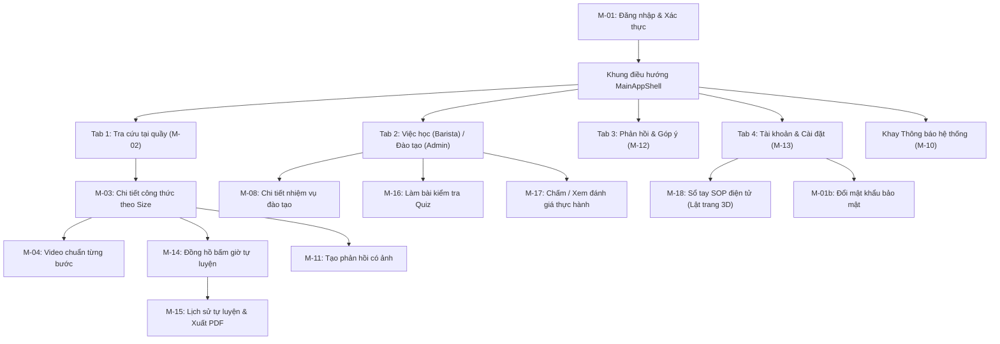
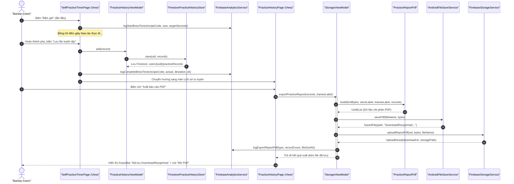

  

    
TRƯỜNG ĐẠI HỌC FPT • BỘ MÔN CÔNG NGHỆ THÔNG TIN

    
PRM393 – PHÁT TRIỂN ỨNG DỤNG DI ĐỘNG (MOBILE PROGRAMMING)

  

  

    <h1 class="cover-title">BÁO CÁO KỸ THUẬT LAB 3</h1>
    <h2 class="cover-subtitle no-break-top">XÂY DỰNG ỨNG DỤNG RECIPEHUB MOBILE VỚI NỀN TẢNG CLOUD FIREBASE VÀ KIẾN TRÚC MVVM</h2>
    

      PHIÊN BẢN PRODUCTION RELEASE
    

    

      
<strong>Học phần:</strong> Phát triển Ứng dụng Di động (PRM393)

      
<strong>Đề tài Lab 3:</strong> RecipeHub Mobile

      
<strong>Sinh viên thực hiện:</strong> Sinh viên: SE183201

      
<strong>Nền tảng kiểm thử vật lý:</strong> Xiaomi Redmi 7 (Android 10 - API 29)

      
<strong>Thời gian thực hiện:</strong> 04/11/2026 – 08/11/2026

    

  

  

    
Hồ Chí Minh, Khóa K18 – Năm 2026

  

## 1. Tổng quan Dự án & Tóm tắt Đặc tả Lab 2

### 1.1. Bối cảnh và Bài toán Nghiệp vụ

Trong ngành dịch vụ ăn uống và đồ uống (F&B), đặc biệt là các chuỗi trà sữa và cà phê quy mô lớn, việc duy trì tính nhất quán về chất lượng đồ uống giữa hàng chục chi nhánh luôn là thách thức cốt lõi. Qua khảo sát thực tế quy trình vận hành chuỗi quầy bar:
- **Công thức và quy trình SOP phân mảnh:** Công thức pha chế thường được in ra sổ tay giấy dễ bám bẩn, hoặc lưu trữ rải rác dưới dạng file PDF dài dòng trên các nhóm chat Zalo/nội bộ. Khi có bản cập nhật mới từ bộ phận R&D, nhân viên không kịp thời nắm bắt, dẫn đến tình trạng cùng một món nhưng mỗi ca pha chế theo một tỷ lệ khác nhau.
- **Áp lực thao tác quầy cao điểm:** Barista tại quầy phục vụ liên tục trong các khung giờ cao điểm; việc tra cứu định lượng nguyên liệu theo từng kích cỡ ly (Size S, M, L) cần được phản hồi tức thì trong vòng 5–10 giây với thao tác một tay trên màn hình cảm ứng di động.
- **Giám sát đào tạo và chấm thực hành thiếu số liệu:** Quản lý cửa hàng (Store Admin) gặp khó khăn trong việc theo dõi nhân sự nào đã đọc quy trình, nhân viên nào chưa hoàn thành bài kiểm tra lý thuyết (Quiz), cũng như việc đánh giá thực hành quầy bar còn dùng giấy tờ thủ công, gây thất lạc và không có dữ liệu đối soát.

**RecipeHub Mobile** được xây dựng nhằm giải quyết triệt để các tồn tại trên bằng cách cung cấp nền tảng số hóa nghiệp vụ toàn diện cho 2 vai trò nòng cốt: **Barista (Viewer)** và **Quản lý cửa hàng (Store Admin)**, kết nối trực tiếp với nền tảng điện toán đám mây Google Firebase và bộ dữ liệu công thức chuẩn hóa của chuỗi Phê La (61 công thức, 25 quy trình SOP).

### 1.2. Chân dung Người dùng (Persona)

Tài liệu thiết kế `docs/lab2/ux/persona.md` xác lập 2 chân dung người dùng đại diện với các yêu cầu vận hành đặc thù:

#### Persona 1: Barista Quầy Bar (Vai trò Viewer)
- **Đại diện tiêu biểu:** Nguyễn Hoàng Tuấn (23 tuổi), Barista / Trưởng ca tại chi nhánh Landmark 81.
- **Môi trường & Thiết bị:** Sử dụng điện thoại di động thông minh Android cỡ màn hình 360–412 dp; thao tác chủ yếu bằng một tay trong không gian quầy bar hẹp, tay thường xuyên ướt hoặc đeo găng tay pha chế.
- **Mục tiêu thao tác:** Tra cứu nhanh công thức đồ uống theo tên không dấu; xem bảng định lượng nguyên liệu chuẩn theo size ly (S, M, L); xem video kỹ thuật chuẩn từng bước pha chế; đọc tài liệu SOP vệ sinh máy và bảo quản; làm bài kiểm tra Quiz định kỳ; tự luyện bấm giờ thao tác chuẩn; gửi phản hồi hiện trường có ảnh khi phát hiện nguyên liệu hoặc công thức có sai lệch.
- **Điểm đau (Pain Points):** Công thức rải rác khó tìm kiếm; không biết phiên bản công thức hiện tại có phải bản mới nhất được ban hành hay không; công thức mới thay đổi nhưng không nhận được thông báo nhắc nhở.

#### Persona 2: Quản lý Cửa hàng (Vai trò Admin)
- **Đại diện tiêu biểu:** Quản lý cửa hàng / Quản lý đào tạo nội bộ chi nhánh.
- **Môi trường & Thiết bị:** Điện thoại Android kết hợp với Web Admin trên máy tính bảng hoặc máy tính quầy thu ngân.
- **Mục tiêu thao tác:** Giám sát trực quan tiến độ học tập của toàn bộ nhân viên trong chi nhánh; phát hiện nhân viên quá hạn đào tạo hoặc cần học lại; chấm điểm thực hành trực tiếp tại quầy theo checklist tiêu chuẩn; tiếp nhận và giải quyết phản hồi từ nhân viên; nhận cảnh báo sự cố kỹ thuật theo thời gian thực.
- **Điểm đau (Pain Points):** Thiếu số liệu tổng hợp về trình độ nhân sự; chấm thi thực hành bằng bảng checklist giấy gây khó khăn khi thống kê đánh giá xếp loại cuối tháng.

### 1.3. Các Luồng Nghiệp vụ Trọng yếu (User Flows từ Lab 2)

Ứng dụng cấu trúc phân luồng điều hướng tập trung qua bộ khung `MainAppShell` gồm 4 tab chính kết hợp biểu tượng thông báo trên thanh tiêu đề:

- **Flow 1 – Tra cứu tại quầy (Counter Lookup Flow):** Barista đăng nhập → Màn hình danh sách công thức (M-02) nạp từ Firestore → Tìm kiếm không dấu theo thời gian thực → Mở chi tiết món (M-03) → Chuyển đổi linh hoạt Size S/M/L hiển thị định lượng tức thì → Mở video hướng dẫn từng bước (M-04).
- **Flow 2 – Tự luyện pha chế & Xuất báo cáo (Self-Practice & Reporting Flow):** Tại màn chi tiết công thức hoặc FAB màn tra cứu → Mở đồng hồ bấm giờ (M-14) → Đo thời gian thao tác thực tế và so sánh dung sai chuẩn ($\pm 5$ giây) → Lưu kết quả vào Firestore → Chuyển sang màn Lịch sử tự luyện (M-15) → Bấm xuất file PDF tiếng Việt Unicode lưu vào thư mục `Download/RecipeHub` và đồng bộ lên Cloud Storage.
- **Flow 3 – Phản hồi hiện trường & Quản lý hai chiều (Feedback & Collaboration Flow):** Barista tạo phản hồi (M-11) → Chọn ảnh từ photo picker hệ thống (giới hạn $< 5$ MB) → Upload lên Cloud Storage và lưu bản ghi vào Firestore → Quản lý (Admin) nhận phản hồi tức thì trên danh sách (M-12) → Mở chi tiết (M-12b) xem ảnh hiện trường và trả lời trao đổi kèm đổi trạng thái xử lý.

### 1.4. Tiêu chí Thành công Kỹ thuật (Success Criteria)
1. **Tốc độ tra cứu quầy bar:** Thời gian tìm kiếm và hiển thị bảng định lượng nguyên liệu của một size ly bất kỳ không vượt quá **10 giây**.
2. **Minh bạch tiến độ đào tạo:** 100% nhiệm vụ học tập bắt buộc phải hiển thị trạng thái chuẩn xác: *Đang học*, *Quá hạn*, *Cần học lại*, hoặc *Hoàn thành*.
3. **Phân tầng đánh giá 3 lớp (Quy tắc BR-01):** Tách bạch rõ ràng 3 cấu phần đánh giá năng lực: Đọc tài liệu SOP/xem video (Lý thuyết cơ bản), Làm bài trắc nghiệm Quiz (Lý thuyết nâng cao), và Chấm quan sát thực hành tại quầy bar.
4. **Chuẩn công thái học di động:** Vùng chạm cảm ứng tối thiểu đạt **48 dp**, chiều cao nút thao tác chính đạt **52 dp**, cỡ chữ nội dung từ **14 sp** trở lên đảm bảo chống mỏi mắt và bấm nhầm trong môi trường làm việc bận rộn.

---

## 2. Truy vết Thiết kế → Mã nguồn (Design Traceability) & Phân tích Sai lệch

### 2.1. Ma trận Truy vết Thiết kế (Traceability Matrix)

Toàn bộ 18 màn hình và phân hệ tính năng được xây dựng bám sát tài liệu đặc tả `docs/design-traceability.md`, phân tách rành mạch theo mô hình MVVM:

| Mã MH | Tên màn hình (View) | Tệp mã nguồn (`lib/...`) | ViewModel phụ trách | Service Interface → Triển khai Production | Sự kiện Analytics kích hoạt |
| :---: | :--- | :--- | :--- | :--- | :--- |
| **M-01** | Đăng nhập quầy bar | `features/auth/login_page.dart` `features/auth/auth_gate.dart` | `AuthViewModel` | `IAuthService` → `FirebaseAuthService` `IUserProfileService` → `FirebaseUserProfileService` | `login` `logout` |
| **M-01b** | Đổi / Quên mật khẩu | `features/account/change_password_page.dart` `features/auth/forgot_password_dialog.dart` | `AuthViewModel` | `IAuthService` → `FirebaseAuthService` | – |
| **M-02** | Tra cứu tại quầy | `features/lookup/counter_recipe_lookup_page.dart` | `RecipeViewModel` `AppConfigViewModel` | `IRecipeSource` → `FirestoreRecipeSource` `IRemoteConfigService` → `FirebaseRemoteConfigService` | – |
| **M-03** | Chi tiết công thức | `features/lookup/recipe_detail_size_page.dart` | `RecipeViewModel` | `IRecipeSource` → `FirestoreRecipeSource` `IAnalyticsService` → `FirebaseAnalyticsService` | `view_recipe` |
| **M-04** | Hướng dẫn bước & Video | `features/lookup/step_video_guide_page.dart` | `StepVideoViewModel` | `VideoPlayerController` (Stream video MP4 từ Firebase Storage `recipe.videoUrl`) | – |
| **M-05** | Thư viện quy trình SOP | `features/sop/sop_catalog_page.dart` | `TrainingViewModel` | `ITrainingRepository` → `FirestoreTrainingRepository` | – |
| **M-06** | Chi tiết quy trình SOP | `features/sop/sop_detail_page.dart` | `TrainingViewModel` `StorageViewModel` | `ITrainingRepository` → `FirestoreTrainingRepository` `IStorageService` → `FirebaseStorageService` | – |
| **M-07** | Việc học của tôi | `features/learning/my_learning_page.dart` | `TrainingViewModel` `AuthViewModel` | `ITrainingRepository` → `FirestoreTrainingRepository` (`learningTasks`) | – |
| **M-08** | Chi tiết nhiệm vụ học | `features/learning/learning_task_detail_page.dart` | `TrainingViewModel` | `ITrainingRepository` → `FirestoreTrainingRepository` (`taskProgress`) | – |
| **M-09** | Tiến độ cá nhân | `features/learning/personal_progress_page.dart` | `TrainingViewModel` `AuthViewModel` | `ITrainingRepository` → `FirestoreTrainingRepository` | – |
| **M-10** | Trung tâm thông báo | `features/learning/notifications_page.dart` | `NotificationViewModel` | `INotificationService` → `FirebaseNotificationService` `IDeviceRegistry` → `FirestoreDeviceRegistry` | – |
| **M-11** | Tạo phản hồi món/SOP | `features/feedback/create_feedback_page.dart` | `StorageViewModel` `RecipeViewModel` | `IFeedbackRepository` → `FirestoreFeedbackRepository` `IStorageService` → `FirebaseStorageService` | `submit_feedback` |
| **M-12** | Danh sách phản hồi | `features/feedback/my_feedback_list_page.dart` | `FeedbackListViewModel` `AuthViewModel` | `IFeedbackRepository` → `FirestoreFeedbackRepository` | – |
| **M-12b**| Chi tiết phản hồi & Trả lời | `features/feedback/feedback_detail_page.dart` | `FeedbackDetailViewModel` | `IFeedbackRepository` → `FirestoreFeedbackRepository` (`replies`) | – |
| **M-13** | Tài khoản & Cài đặt | `features/account/account_profile_page.dart` | `AuthViewModel` `AppConfigViewModel` | `IAuthService` → `FirebaseAuthService` `ICrashReporter` → `FirebaseCrashReporter` | `logout` `trigger_test_crash` |
| **M-14** | Tự luyện bấm giờ | `features/practice/self_practice_timer_page.dart` | `RecipeViewModel` `PracticeHistoryViewModel` | `IPracticeHistoryStore` → `FirestorePracticeHistoryStore` `IAnalyticsService` → `FirebaseAnalyticsService` | `start_brew_timer` `complete_brew_timer` |
| **M-15** | Lịch sử tự luyện & PDF | `features/practice/practice_history_page.dart` | `PracticeHistoryViewModel` `StorageViewModel` | `IPracticeHistoryStore` → `FirestorePracticeHistoryStore` `IFileSaveService` → `AndroidFileSaveService` | `export_report_pdf` |
| **M-16** | Làm bài kiểm tra Quiz | `features/practice/quiz_exam_page.dart` | `TrainingViewModel` `AuthViewModel` | `ITrainingRepository` → `FirestoreTrainingRepository` (`quizzes`) | – |
| **M-17** | Chấm điểm thực hành | `features/practice/practical_evaluation_page.dart` | `TrainingViewModel` `AdminTrainingViewModel` | `ITrainingRepository` → `FirestoreTrainingRepository` (`evaluations`) | – |
| **M-18** | Sổ tay SOP lật trang 3D | `features/sop_book/sop_book_page.dart` | `SopBookViewModel` `TrainingViewModel` | `IRecipeSource` → `FirestoreRecipeSource` `IFileSaveService` → `AndroidFileSaveService` | – |
| **Admin** | Đào tạo chi nhánh | `features/admin_training/admin_store_training_page.dart` | `AdminTrainingViewModel` `AuthViewModel` | `ITrainingRepository` → `FirestoreTrainingRepository` (Nhân sự thật) | – |
| **Hệ thống**| Chuyển tiếp / Báo lỗi | `features/system/loading_transition_page.dart` `features/system/error_recovery_page.dart` | `RecipeViewModel` `AuthViewModel` | `core/widgets/load_state_view.dart` | – |

### 2.2. Bảng Phân tích Sai lệch so với Thiết kế Ban đầu (Design Deviations)

Trong các đợt chạy thử nghiệm trực tiếp trên thiết bị vật lý Xiaomi Redmi 7 vào ngày **07–08/11/2026**, chủ dự án đã yêu cầu điều chỉnh 8 điểm so với bản mẫu Figma Lab 2 nhằm tối ưu hóa tính tiện dụng tại quầy bar:

| # | Hạng mục thay đổi | Bản thiết kế Figma (Lab 2) | Triển khai thực tế trong Mã nguồn | Lý do điều chỉnh kỹ thuật & Nghiệp vụ |
| :-: | :--- | :--- | :--- | :--- |
| 1 | **Ẩn hoàn toàn mã món trên UI** | Hiển thị mã kỹ thuật thô (`CF-CB-01`, `TS-OL-02`) trên thẻ danh sách và màn chi tiết | Ẩn hoàn toàn mã món khỏi UI; chỉ hiển thị tên món, nhóm món và quy cách phục vụ | Nhân viên tại quầy chỉ nhận diện món bằng tên gọi thực tế. Mã món chỉ dùng làm khóa nội bộ trong Cloud Firestore và định danh tham số Analytics. |
| 2 | **Bỏ chip "Ban hành · version" ở thẻ tra cứu** | Mỗi thẻ công thức tại quầy đều gắn chip xanh in "Ban hành · v2.0" | Loại bỏ chip khỏi thẻ tra cứu; chỉ giữ lại số bước chuẩn và thời gian hoàn thành | Tối giản diện tích thẻ trên màn hình 360dp, tập trung vào thông tin pha chế khẩn cấp; thông tin phiên bản đưa vào màn chi tiết. |
| 3 | **Bỏ khối chi nhánh tại màn Tài khoản** | Màn Tài khoản có khối chọn hoặc hiển thị chi nhánh hoạt động | Bỏ khối thông tin chi nhánh, chỉ giữ thông tin người dùng và vai trò | Hệ thống chưa quản lý bảng dữ liệu chi nhánh độc lập (`stores`), tuyệt đối không đưa dữ liệu giả lập (mock) lên giao diện. |
| 4 | **Tổ chức SOP vào Sổ tay điện tử** | Màn Tra cứu có nút/chip dẫn sang Thư viện SOP riêng | Tách SOP thành mục "Sổ tay SOP" tại màn Tài khoản với cơ chế lật trang 3D và xuất PDF | Màn Tra cứu cần tập trung 100% vào việc tìm đồ uống pha chế liên tục; SOP là tài liệu đào tạo chuyên sâu, việc gom vào sổ tay điện tử giúp tra cứu tập trung và dễ in ấn. |
| 5 | **Phân quyền giao diện Admin** | Mọi tài khoản đều có thanh tiến độ học tập và nút FAB tự luyện | Kiểm tra thuộc tính `hasPersonalLearning` (`false` khi là Admin) để ẩn tự luyện và tiến độ cá nhân | Store Admin đóng vai trò người giám sát, đánh giá và chấm thi nhân sự; việc ẩn các tính năng cá nhân giúp giao diện Admin tập trung vào "Bảng theo dõi đào tạo chi nhánh". |
| 6 | **Tối giản nút thao tác phụ** | Nút phụ trên AppBar có cả biểu tượng và chuỗi văn bản dài | Chuyển thành icon tròn/vuông gọn gàng có gắn thuộc tính Semantics và Tooltip | Ngăn ngừa triệt để lỗi tràn ngang (overflow) trên các thiết bị di động có bề rộng vật lý hẹp, đồng thời bảo đảm khả năng tiếp cận TalkBack. |
| 7 | **Bỏ khối quy tắc nghiệp vụ (BR) thô** | Màn hình hiển thị các khung chữ nhật in văn bản quy tắc BR khô khan | Loại bỏ hoàn toàn các khối chữ quy tắc thô khỏi giao diện người dùng | Khối văn bản tĩnh gây rối mắt và không hỗ trợ thao tác quầy; logic nghiệp vụ được ràng buộc trực tiếp bằng mã kiểm tra trong ViewModel. |
| 8 | **Chuyển đổi nguồn dữ liệu chính** | Gọi Gateway API YARP (.NET 8) cục bộ qua giao thức HTTP REST | Sử dụng trực tiếp **Cloud Firestore (real-time)** với bộ Security Rules chặt chẽ | Máy chủ .NET chưa triển khai môi trường cloud chính thức và quy định đồ án cấm server cục bộ ngoài phạm vi; Firestore đáp ứng tính sẵn sàng cao, bảo mật và đồng bộ tức thì. |

---

## 3. Kiến trúc Phần mềm MVVM & Thiết kế Phân tầng

### 3.1. Phân tầng Trách nhiệm (Separation of Concerns)

Ứng dụng RecipeHub Mobile áp dụng mô hình kiến trúc **MVVM (Model - View - ViewModel)** kết hợp chặt chẽ với giải pháp quản lý trạng thái **Provider** và nguyên lý đảo ngược phụ thuộc (Dependency Inversion Principle - DIP):
- **Tầng Giao diện (View - `lib/features/*`):** Chịu trách nhiệm hiển thị các Widget khai báo (Declarative UI), lắng nghe sự thay đổi trạng thái từ ViewModel thông qua `context.watch<T>()` hoặc kích hoạt các hàm xử lý nghiệp vụ thông qua `context.read<T>()`. Toàn bộ các View tuyệt đối **không được import trực tiếp** bất kỳ SDK Firebase nào (Auth, Firestore, Storage, Messaging, Remote Config, Crashlytics).
- **Tầng Mô hình Giao diện (ViewModel - `lib/core/viewmodels/*`):** Kế thừa từ `ChangeNotifier`, đóng vai trò trung tâm điều phối logic giao diện. Mỗi ViewModel quản lý trạng thái đồng bộ (loading, ready, empty, error), thực hiện kiểm tra dữ liệu đầu vào và giao tiếp với hạ tầng thông qua các hợp đồng Service Interface. Khi dữ liệu thay đổi, ViewModel gọi `notifyListeners()` để kích hoạt vẽ lại giao diện cục bộ.
- **Tầng Giao diện Dịch vụ (Service Interfaces - `lib/core/services/interfaces/*`):** Định nghĩa các hợp đồng trừu tượng (như `IAuthService`, `IRecipeSource`, `ITrainingRepository`, `IStorageService`, `IAnalyticsService`), giúp mã nguồn nghiệp vụ hoàn toàn độc lập với công nghệ cụ thể.
- **Tầng Triển khai Dịch vụ (Service Implementations - `lib/core/services/firebase/*`):** Hiện thực hóa các interface bằng Firebase SDK chính thức hoặc API hệ thống Android (`AndroidFileSaveService`).
- **Điểm Khởi tạo Phụ thuộc (Composition Root - `lib/core/di/app_services.dart`):** Nơi lắp ráp và tiêm phụ thuộc (Dependency Injection), cho phép chuyển đổi linh hoạt giữa môi trường production thật (`AppServices.firebase()`) và môi trường kiểm thử giả lập (`AppServices.mock()`).

### 3.2. Sơ đồ Lớp MVVM (Mermaid Class Diagram)

```mermaid
classDiagram
    direction TB

    %% Service Interfaces
    class IAuthService {
        <<interface>>
        +authStateChanges() Stream~AppUser~
        +signInWithGoogle() Future~AppUser~
        +signInWithEmail(email, password) Future~AppUser~
        +sendPasswordReset(email) Future~void~
        +changePassword(current, next) Future~void~
        +signOut() Future~void~
    }
    class IRecipeSource {
        <<interface>>
        +searchApproved(pageSize) Future~RecipePageResponse~
        +getRecipe(id) Future~RecipeDetailResponse~
    }
    class ITrainingRepository {
        <<interface>>
        +watchSops() Stream~List~SopItem~~
        +watchTasks() Stream~List~LearningTaskItem~~
        +watchProgress(uid) Stream~Map~
        +watchQuizzes() Stream~List~QuizSet~~
        +submitQuiz(uid, quiz, answers) Future
        +watchStaff() Stream~List~StaffMember~~
        +saveEvaluation(record, evaluatorUid) Future
    }
    class IFeedbackRepository {
        <<interface>>
        +create(newFeedback) Future
        +watchMine(uid) Stream~List~FeedbackItemModel~~
        +watchAll() Stream~List~FeedbackItemModel~~
        +reply(feedbackId, msg) Future
    }
    class IStorageService {
        <<interface>>
        +uploadFeedbackImage(uid, media) Future~UploadResult~
        +uploadReportPdf(uid, bytes, fileName) Future~UploadResult~
    }
    class IAnalyticsService {
        <<interface>>
        +logLogin(method, role) Future
        +logViewRecipe(code, cat, size, source) Future
        +logStartBrewTimer(code, size, target) Future
        +logCompleteBrewTimer(code, size, actual, dev, ok) Future
        +logSubmitFeedback(type, targetType, code, hasImage) Future
        +logExportReportPdf(type, count, sizeKb) Future
    }

    %% Service Implementations
    class FirebaseAuthService {
        -FirebaseAuth _auth
    }
    class FirestoreRecipeSource {
        -FirebaseFirestore _db
    }
    class FirestoreTrainingRepository {
        -FirebaseFirestore _db
    }
    class FirestoreFeedbackRepository {
        -FirebaseFirestore _db
    }
    class FirebaseStorageService {
        -FirebaseStorage _storage
    }
    class FirebaseAnalyticsService {
        -FirebaseAnalytics _analytics
    }

    IAuthService <|.. FirebaseAuthService
    IRecipeSource <|.. FirestoreRecipeSource
    ITrainingRepository <|.. FirestoreTrainingRepository
    IFeedbackRepository <|.. FirestoreFeedbackRepository
    IStorageService <|.. FirebaseStorageService
    IAnalyticsService <|.. FirebaseAnalyticsService

    %% ViewModels
    class AuthViewModel {
        +AuthStatus status
        +AppUser user
        +UserRole role
        +bool hasPersonalLearning
        +signInWithGoogle() Future
        +signInWithEmail(email, pass) Future
        +signOut() Future
    }
    class RecipeViewModel {
        +ViewState state
        +List~RecipeItem~ items
        +load() Future
        +searchAll(query) Future
    }
    class TrainingViewModel {
        +LoadState sopState
        +List~SopItem~ sops
        +List~LearningTaskItem~ tasks
        +submitQuiz(quiz, answers) Future
    }
    class AdminTrainingViewModel {
        +List~StaffMember~ staff
        +List~StaffSummary~ summaries
        +saveEvaluation(r, evaluatorUid) Future
    }
    class FeedbackListViewModel {
        +FeedbackListState state
        +bind(uid, isAdmin) void
        +setFilter(filter) void
    }
    class StorageViewModel {
        +PickedMedia attachment
        +pickAttachment(fromCamera) Future
        +uploadAttachment() Future
        +exportPracticeReport(records, label) Future
    }

    AuthViewModel --> IAuthService : uses
    AuthViewModel --> IAnalyticsService : uses
    RecipeViewModel --> IRecipeSource : uses
    TrainingViewModel --> ITrainingRepository : uses
    AdminTrainingViewModel --> ITrainingRepository : uses
    FeedbackListViewModel --> IFeedbackRepository : uses
    StorageViewModel --> IStorageService : uses
    StorageViewModel --> IAnalyticsService : uses

    %% Views
    class CounterRecipeLookupPage {
        +build(context) Widget
    }
    class RecipeDetailSizePage {
        +build(context) Widget
    }
    class MyLearningPage {
        +build(context) Widget
    }
    class AdminStoreTrainingPage {
        +build(context) Widget
    }
    class MyFeedbackListPage {
        +build(context) Widget
    }
    class CreateFeedbackPage {
        +build(context) Widget
    }

    CounterRecipeLookupPage ..> RecipeViewModel : observes
    RecipeDetailSizePage ..> RecipeViewModel : reads
    RecipeDetailSizePage ..> IAnalyticsService : logs view_recipe
    MyLearningPage ..> TrainingViewModel : observes
    AdminStoreTrainingPage ..> AdminTrainingViewModel : observes
    MyFeedbackListPage ..> FeedbackListViewModel : observes
    CreateFeedbackPage ..> StorageViewModel : uses
    CreateFeedbackPage ..> IFeedbackRepository : creates
```

### 3.3. Luồng Tuần tự: Tự luyện Pha chế và Xuất Báo cáo PDF (Sequence Diagram)

Sơ đồ trình bày chi tiết luồng xử lý tương tác từ khi Barista bấm giờ pha chế, lưu kết quả tự luyện vào Firestore, đến khi sinh file PDF tiếng Việt Unicode lưu vào thư mục máy (`Download/RecipeHub`) và upload bản sao lên Firebase Cloud Storage:

### 3.4. Bảng Ma trận 12 ViewModel ↔ Dịch vụ (Service Matrix)

Toàn bộ 12 ViewModel của ứng dụng được chuẩn hóa với các trách nhiệm và giao diện phụ thuộc cụ thể:

| # | Tên ViewModel | Tệp mã nguồn | Service Interface phụ thuộc | Triển khai Production (Firebase / Thiết bị) | Trách nhiệm Nghiệp vụ & Quản lý Dữ liệu |
| :-: | :--- | :--- | :--- | :--- | :--- |
| 1 | `AuthViewModel` | `core/viewmodels/auth_viewmodel.dart` | `IAuthService` `IAnalyticsService` `ICrashReporter` `IUserProfileService?` | `FirebaseAuthService` `FirebaseAnalyticsService` `FirebaseCrashReporter` `FirebaseUserProfileService` | Quản lý phiên đăng nhập (Google, Email/Mật khẩu, Khách); đổi mật khẩu, quên mật khẩu; đồng bộ vai trò custom claim `role`, lắng nghe sự kiện tài khoản bị khóa (`disabled`). |
| 2 | `AppConfigViewModel` | `core/viewmodels/app_config_viewmodel.dart` | `IRemoteConfigService` | `FirebaseRemoteConfigService` | Lắng nghe cấu hình động thời gian thực từ Remote Config: `max_lookup_results` (giới hạn món tại quầy), `enable_ai_assist`, `show_crash_demo`. |
| 3 | `RecipeViewModel` | `core/viewmodels/recipe_viewmodel.dart` | `IRecipeSource` `ICrashReporter` | `FirestoreRecipeSource` `FirebaseCrashReporter` | Nạp danh mục công thức ban hành (`recipes`); tìm kiếm không dấu thời gian thực trên server (`searchAll`); quản lý trạng thái loading/empty/error. |
| 4 | `TrainingViewModel` | `core/viewmodels/training_viewmodel.dart` | `ITrainingRepository` `ICrashReporter` | `FirestoreTrainingRepository` `FirebaseCrashReporter` | Dữ liệu đào tạo real-time của Barista: SOP (`sops`), Nhiệm vụ học (`learningTasks`), Tiến độ từng mục (`users/{uid}/taskProgress`), Quiz (`quizzes`), Lịch sử làm bài (`quizAttempts`). |
| 5 | `AdminTrainingViewModel` | `core/viewmodels/training_viewmodel.dart` | `ITrainingRepository` `ICrashReporter` | `FirestoreTrainingRepository` `FirebaseCrashReporter` | Dành riêng cho Store Admin: Giám sát danh sách Barista thật (`users`), tỷ lệ hoàn thành đọc SOP, nhiệm vụ quá hạn, mẫu tiêu chí chấm (`evaluationCriteria`), chấm và lưu kết quả thực hành tại quầy (`evaluations`). |
| 6 | `PracticeHistoryViewModel` | `core/viewmodels/practice_history_viewmodel.dart` | `IPracticeHistoryStore` `ICrashReporter` | `FirestorePracticeHistoryStore` `FirebaseCrashReporter` | Lưu và nạp lịch sử bấm giờ tự luyện (`users/{uid}/practiceRecords`); tính toán thời gian pha trung bình và tỷ lệ đạt chuẩn dung sai ($\pm 5$ giây). |
| 7 | `FeedbackListViewModel` | `core/viewmodels/feedback_viewmodel.dart` | `IFeedbackRepository` `ICrashReporter` | `FirestoreFeedbackRepository` `FirebaseCrashReporter` | Lắng nghe real-time danh sách phản hồi: Barista chỉ thấy phản hồi của chính mình, Admin thấy toàn bộ phản hồi; lọc theo trạng thái (`open`, `waitingInfo`, `resolved`). |
| 8 | `FeedbackDetailViewModel` | `core/viewmodels/feedback_viewmodel.dart` | `IFeedbackRepository` `ICrashReporter` | `FirestoreFeedbackRepository` `FirebaseCrashReporter` | Chi tiết phản hồi và luồng hội thoại 2 chiều (`feedback/{id}/replies`); Admin gửi trả lời và cập nhật trạng thái phản hồi tức thì. |
| 9 | `StorageViewModel` | `core/viewmodels/storage_viewmodel.dart` | `IStorageService` `IMediaPickerService` `IAuthService` `IAnalyticsService` `IFileSaveService?` | `FirebaseStorageService` `ImagePickerMediaService` `FirebaseAuthService` `FirebaseAnalyticsService` `AndroidFileSaveService` | Chọn ảnh máy ảnh/thư viện (giới hạn $< 5$ MB), upload ảnh đính kèm phản hồi lên `feedback/{uid}/`; tạo file PDF báo cáo tự luyện, lưu máy tại `Download/RecipeHub` và upload lên `reports/{uid}/`. |
| 10 | `NotificationViewModel` | `core/viewmodels/notification_viewmodel.dart` | `INotificationService` `ICrashReporter` `IDeviceRegistry` | `FirebaseNotificationService` `FirebaseCrashReporter` `FirestoreDeviceRegistry` | Tiếp nhận thông báo FCM (foreground, background, terminated); đăng ký FCM token lên Firestore `users/{uid}/devices/{token}`; xử lý điều hướng sâu (deep link). |
| 11 | `SopBookViewModel` | `core/viewmodels/sop_book_viewmodel.dart` | `IRecipeSource` `IFileSaveService?` | `FirestoreRecipeSource` `AndroidFileSaveService` | Nạp toàn bộ công thức và SOP ban hành để dựng sổ tay điện tử; lưu số trang đang đọc vào SharedPreferences; xuất toàn bộ sổ tay ra file PDF lưu về máy. |
| 12 | `StepVideoViewModel` | `core/viewmodels/step_video_viewmodel.dart` | Plugin `VideoPlayerController` | `video_player` native | Phát video kỹ thuật chuẩn (URL từ Firestore `recipe.videoUrl`), đồng bộ timeline bước pha chế với video, hỗ trợ chế độ xem toàn màn hình landscape. |

---

## 4. Hệ thống Thiết kế NomadKit (Design System)

Hệ thống thiết kế **NomadKit** (`lib/core/theme/nomad_kit.dart`) được xây dựng nhằm đem lại trải nghiệm thị giác ấm áp, độ tương phản cao, đặc biệt phù hợp với không gian ánh sáng vàng tại quầy pha chế:

### 4.1. Bảng Token Màu Sắc (Color Tokens)

| Token Code | Mã Màu Hex | Vai trò & Mục đích sử dụng |
| :--- | :--- | :--- |
| `NomadKit.canvas` | `#FFFDF7` | Màu nền chủ đạo toàn bộ ứng dụng (nền kem nhẹ chống mỏi mắt) |
| `NomadKit.surface` | `#FFFFFF` | Nền các thẻ thành phần (Cards), bảng biểu và hộp thoại nổi |
| `NomadKit.sand` | `#C49A6C` | Màu nhấn chính (Primary Accent): Logo, nút thao tác chính (FAB), tab active |
| `NomadKit.sandDark` | `#A07040` | Nâu đậm: Nhãn mục, tiêu đề phần, trạng thái nhấn giữ |
| `NomadKit.sandLight` | `#FAF6F0` | Nền thẻ nhấn nhẹ, phông nền lối tắt thao tác |
| `NomadKit.ink` | `#292524` | Màu chữ chính (Primary Text): Độ tương phản cao chuẩn WCAG AAA trên nền kem |
| `NomadKit.secondary` | `#78716C` | Màu chữ phụ (Secondary Text): Ghi chú, thời gian, đơn vị đo lường |
| `NomadKit.border` | `#E7E0D5` | Đường viền mảnh 1 dp ngăn cách các khối giao diện |
| `NomadKit.forest` / `forestLight` | `#166534` / `#DCFCE7` | Trạng thái Đạt, Đã ban hành, Hoàn thành nhiệm vụ |
| `NomadKit.ocean` / `oceanLight` | `#0891B2` / `#F0F9FF` | Thông tin hướng dẫn, liên kết tài liệu SOP |
| `NomadKit.warning` / `warningLight` | `#CA8A04` / `#FEF9C3` | Cảnh báo sắp hết hạn, bản ghi chú nháp |
| `NomadKit.error` | `#DC2626` | Báo lỗi hệ thống, nhiệm vụ quá hạn, kết quả kiểm tra Chưa đạt |

### 4.2. Kiểu Chữ và Quy tắc Công thái học (Typography & Ergonomics)
- **Kiểu chữ:** Sử dụng phông sans-serif chuẩn hệ thống (`Roboto` / `Noto Sans`); riêng các thông số định lượng số học và mã định danh dùng định dạng monospace chống nhầm lẫn chữ số (như `0` và `O`, `1` và `l`).
- **Phân cấp kích thước chữ:** Văn bản nội dung thân bài đạt **14–15 sp**; các chỉ dẫn thao tác nhanh tại quầy bar sử dụng kích thước lớn **18–22 sp** để Barista có thể đọc rõ ràng từ khoảng cách 50–70 cm.
- **Quy tắc lề và khoảng cách:** Toàn bộ khoảng cách tuân thủ bội số của 4 dp (`4, 8, 12, 16, 24 dp`), lề ngang an toàn của màn hình là **16 dp**.
- **Bo góc (Border Radius):** Bo góc phân tầng có hệ thống: `4 dp` cho nhãn badge, `8 dp` cho ô nhập liệu (TextFormField), `14 dp` cho thẻ công thức (Card), `16 dp` cho nút bấm chính và hộp thoại, và `999 dp (pill)` cho các chip trạng thái.
- **Khu vực tương tác cảm ứng:** Chiều cao nút chính tối thiểu **52 dp**, toàn bộ các biểu tượng thao tác và mục danh sách đều có vùng chạm (touch target) tối thiểu **48 dp**, ngăn chặn triệt để thao tác bấm trượt trong giờ cao điểm.

---

## 5. Tích hợp 7 Dịch vụ Firebase & Cơ chế Xử lý Ngoại lệ

Toàn bộ ứng dụng kết nối trực tiếp với dự án Firebase production `recipehub-mobile`. Mỗi dịch vụ đều được bảo bọc bởi tầng trừu tượng Service Interface và cơ chế xử lý lỗi chặt chẽ:

### 5.1. Firebase Authentication (`IAuthService` → `FirebaseAuthService`)
- **Phương thức hỗ trợ:** Đăng nhập Email/Mật khẩu do Admin cấp; Đăng nhập Google Sign-In thông qua Account Picker hệ thống Android; Chế độ Đăng nhập Khách (Anonymous Guest).
- **Phân quyền người dùng:** Sau khi xác thực, hệ thống trích xuất vai trò (`admin` hoặc `viewer`) từ custom claim trong ID Token (do Cloud Functions thiết lập), đồng thời đối soát tức thì với hồ sơ bảo mật `users/{uid}` trên Firestore.
- **Cơ chế xử lý lỗi:** 
  - Khi mất kết nối mạng: Báo lỗi thân thiện "Không có kết nối mạng. Vui lòng kiểm tra Wi-Fi/4G." (mã `AuthFailureCode.network`).
  - Khi người dùng bấm Back hủy chọn tài khoản Google: Ứng dụng giữ nguyên trạng thái chưa đăng nhập và thông báo SnackBar trung tính "Bạn đã hủy đăng nhập Google. Chưa có thay đổi nào." (mã `AuthFailureCode.cancelled`), **tuyệt đối không gửi lỗi này lên Crashlytics** (theo cải tiến CR-09).
  - Khi tài khoản bị Admin khóa trên Web: Lắng nghe snapshot `users/{uid}.disabled == true` và tự động đăng xuất tức thì, hiển thị thông báo rõ ràng tại màn đăng nhập (theo cải tiến CR-10).
- **Minh chứng kiểm thử:** Ảnh chụp Console xác thực người dùng đã làm mờ tại `../evidence/lab3/06-firebase-console/...`.

### 5.2. Cloud Firestore (`FirestoreRecipeSource`, `FirestoreTrainingRepository`, ...)
- **Dữ liệu thật:** Xóa bỏ hoàn toàn mã giả `MockDataService`. Toàn bộ 61 công thức pha chế theo size và 25 tài liệu SOP chuẩn của chuỗi Phê La được nạp trực tiếp vào Firestore collections: `recipes`, `sops`, `learningTasks`, `quizzes`, `evaluationCriteria`.
- **Cơ chế đồng bộ thời gian thực:** Sử dụng luồng `snapshots()` cho danh mục phản hồi (`feedback`), tiến độ học tập (`users/{uid}/taskProgress`), và danh sách nhân sự đào tạo (`users`).
- **Mô hình Bảo mật (Security Rules - `firebase/firestore.rules`):**
  - `users/{uid}`: Chỉ chính chủ đọc hoặc Admin; Client chỉ được phép cập nhật thời điểm `lastSeenAt`; các trường `role` và `disabled` chỉ Cloud Functions có quyền ghi.
  - `recipes`, `sops`, `learningTasks`: Mọi tài khoản đăng nhập đều có quyền đọc các tài liệu đã ban hành; chỉ Admin có quyền tạo hoặc chỉnh sửa.
  - `quizzes`: Người dùng chỉ đọc câu hỏi, không chứa đáp án. Subcollection `answerKey` chỉ cho phép đọc sau khi người dùng đã nộp bài lần đầu tiên (`quizAttempts`).
  - `feedback`: Barista chỉ đọc và ghi phản hồi của chính mình; Admin có quyền đọc toàn bộ, gửi phản hồi và cập nhật trạng thái.
  - `incidents`: Mọi client đăng nhập đều có quyền ghi nhận sự cố (fatal/non-fatal); chỉ Admin có quyền đọc và cập nhật trạng thái xử lý trên Web.
- **Minh chứng kiểm thử:** Ảnh chụp màn hình ứng dụng nạp dữ liệu thật tại `../evidence/lab3/02-seed-real-data/...`.

### 5.3. Cloud Storage (`IStorageService` → `FirebaseStorageService`)
- **Nghiệp vụ lưu trữ:** Lưu trữ ảnh đính kèm phản hồi hiện trường tại `feedback/{uid}/{file}`, lưu trữ bản sao báo cáo tự luyện PDF tại `reports/{uid}/{file}`, lưu trữ tài liệu SOP gốc tại `sop/{file}`, và phát video kỹ thuật chuẩn tại `recipe-videos/{code}/{file}`.
- **Mô hình Bảo mật (Security Rules - `firebase/storage.rules`):**
  - Chặn nghiêm ngặt kích thước file: Tối đa **5 MB** cho ảnh và PDF; tối đa **100 MB** cho video MP4.
  - Kiểm tra loại nội dung (Content-Type): Chỉ chấp nhận định dạng ảnh hợp lệ `image/(png|jpeg|jpg|webp|heic|heif)` và PDF `application/pdf`; **chặn tuyệt đối file SVG** (nguy cơ tấn công XSS thông qua mã kịch bản nhúng).
- **Xử lý lỗi:** Khi người dùng chọn file vượt quá 5 MB, hệ thống chủ động chặn ngay tại máy và hiển thị thông báo "Ảnh vượt quá 5MB"; khi mất mạng giữa lúc tải ảnh, luồng upload tự động tạm dừng và tiếp tục khi có mạng trở lại.
- **Minh chứng kiểm thử:** Ảnh chụp quy trình gửi phản hồi kèm ảnh tại `../evidence/lab3/01-feedback-realtime/...`.

### 5.4. Firebase Cloud Messaging (FCM - `INotificationService` → `FirebaseNotificationService`)
- **Cấu hình & Đăng ký:** Khi người dùng đăng nhập thành công, FCM Token được tự động trích xuất và lưu vào Firestore subcollection `users/{uid}/devices/{token}` kèm thông tin thiết bị (`model: Redmi 7`, `osVersion: Android 10`).
- **Kênh thông báo chuẩn Android 10+:** Tạo Notification Channel `recipehub_updates` với mức ưu tiên cao (`IMPORTANCE_HIGH`), đảm bảo thông báo hiển thị nổi và phát âm thanh trên giao diện MIUI của Xiaomi.
- **Xử lý 3 trạng thái ứng dụng:**
  - *Foreground (Ứng dụng đang mở):* Nhận tin tức thì, hiển thị banner SnackBar nổi (`SnackBarBehavior.floating`) kèm nút bấm "Xem", đồng thời bật chấm đỏ chỉ báo trên icon quả chuông AppBar.
  - *Background (Ứng dụng ẩn dưới nền):* Hiển thị thông báo trên khay hệ thống Android (Notification Shade).
  - *Terminated (Ứng dụng bị đóng hoàn toàn):* Thiết bị đánh thức tiến trình ngầm; khi người dùng chạm vào thông báo trên khay hệ thống, ứng dụng thực hiện khởi động lạnh và điều hướng chính xác vào màn hình chi tiết món hoặc SOP tương ứng (Deep Link).
- **Minh chứng kiểm thử:** Kết quả kiểm thử thủ công ngày 08/11/2026 với 5 ảnh bằng chứng tại `../evidence/lab3/06-firebase-console/...`.

### 5.5. Firebase Analytics (`IAnalyticsService` → `FirebaseAnalyticsService`)
- **Nguyên tắc an toàn dữ liệu (No PII):** Tuyệt đối không thu thập email, họ tên, số điện thoại hay thông tin cá nhân. Hàm `AnalyticsEvent.sanitize` tự động kiểm tra và loại bỏ mọi chuỗi chứa ký tự `@` hoặc dãy số $\ge 9$ chữ số liên tiếp.
- **User Properties:** Thiết lập `user_role` (`admin` / `viewer`), `auth_mode` (`password` / `google` / `guest`), và `store_code`.
- **Ghi nhận trung thực về công cụ kiểm chứng:** Trong quá trình phát triển trên thiết bị thật Xiaomi Redmi 7, mục **DebugView trên Firebase Console không hiển thị luồng sự kiện thời gian thực** mặc dù logcat thiết bị xác nhận event được gửi kèm cờ `_dbg` và gói tin upload trả về HTTP 204 (`01-analytics-debug-logcat.log`). Do đó, nhóm phát triển sử dụng **Báo cáo Sự kiện chuẩn của Google Analytics (GA4 Events Report)** kết hợp với lệnh lọc logcat thiết bị `adb logcat -s FA-SVC` để làm minh chứng xác thực 100%.
- **Minh chứng kiểm thử:** Bảng số liệu thực tế được ghi nhận trực tiếp từ ảnh chụp Console `../evidence/lab3/06-firebase-console/01-analytics-events.jpg` (Tổng 511 sự kiện, 8 người dùng thử nghiệm).

### 5.6. Firebase Crashlytics (`ICrashReporter` → `FirebaseCrashReporter`)
- **Bắt lỗi toàn diện:** Tích hợp bộ bắt lỗi toàn cục trong `firebase_bootstrap.dart`:
  - `FlutterError.onError`: Phân biệt rõ lỗi fatal và non-fatal; các lỗi giao diện thông thường (như lỗi overflow) được ghi qua `recordFlutterError` (non-fatal) để không làm sai lệch chỉ số tỷ lệ phiên không crash (Crash-free users).
  - `PlatformDispatcher.instance.onError`: Bắt các ngoại lệ bất đồng bộ cấp nền tảng (fatal crash).
- **Lọc nhiễu dữ liệu (CR-09):** Chủ động chặn không gửi các tình huống ngoại lệ dự kiến lên Crashlytics (chẳng hạn người dùng mất mạng khi bấm đăng nhập, hoặc người dùng cố tình bấm hủy hộp thoại Google Sign-In).
- **Phối hợp giám sát sự cố (Incident Response):** Khi ứng dụng gặp sự cố fatal hoặc người dùng kích hoạt tính năng "Kiểm thử sự cố" tại màn Tài khoản, ứng dụng đồng thời ghi dữ liệu vào collection `incidents/` trên Firestore. Web Admin sẽ lập tức phát âm thanh cảnh báo và hiển thị banner đỏ trong vòng **1 giây** để đội ngũ kỹ thuật can thiệp.
- **Minh chứng kiểm thử:** Ảnh chụp cấu hình Crashlytics tại `../evidence/lab3/06-firebase-console/...`.

### 5.7. Firebase Remote Config (`IRemoteConfigService` → `FirebaseRemoteConfigService`)
- **Các tham số cấu hình động:**
  - `max_lookup_results` (mặc định: `50`): Giới hạn số lượng món hiển thị tại danh sách tra cứu quầy bar.
  - `enable_ai_assist` (mặc định: `false`): Bật/tắt tính năng trợ lý công thức AI.
  - `show_crash_demo` (mặc định: `true`): Ẩn/hiện nút kiểm thử sự cố trong màn Tài khoản.
- **Cơ chế cập nhật thời gian thực:** Kết hợp phương thức `fetchAndActivate()` khi khởi động và lắng nghe luồng cập nhật cấu hình `onConfigUpdated`. Khi giá trị `max_lookup_results` thay đổi trên Firebase Console, màn hình tra cứu quầy bar tự động điều chỉnh số lượng thẻ hiển thị trong vòng **30 giây đến 4 phút** mà người dùng không cần khởi động lại ứng dụng.
- **Minh chứng kiểm thử:** Ảnh chụp tham số và lịch sử phiên bản Remote Config tại `../evidence/lab3/06-firebase-console/...`.

---

## 6. Kế hoạch Đo lường Firebase Analytics & Báo cáo Số liệu Thực tế

### 6.1. Danh mục 8 Sự kiện Chuẩn trong Mã nguồn

Toàn bộ 8 sự kiện được định nghĩa chặt chẽ trong `IAnalyticsService` và tích hợp tại các điểm thao tác tương ứng:

| # | Tên Event (`snake_case`) | Điểm kích hoạt trong Mã nguồn | Tham số đính kèm | Câu hỏi sản phẩm cần giải quyết | Luồng Lab 2 |
| :-: | :--- | :--- | :--- | :--- | :--- |
| 1 | `login` | `AuthViewModel._onSignedIn` (Sau khi xác thực thành công) | `method`: string (`google`, `password`, `guest`) `user_role`: string (`admin`, `viewer`) | Tỷ lệ đăng nhập bằng Google, Email hay Khách? Có bao nhiêu Admin đăng nhập từ thiết bị di động? | Flow 1 |
| 2 | `logout` | `AuthViewModel.signOut` (Xác nhận đăng xuất an toàn) | `user_role`: string (`admin`, `viewer`) `session_minutes`: int | Một ca tra cứu hoặc luyện tập tại quầy kéo dài bao nhiêu phút theo từng vai trò? | Flow 3 |
| 3 | `view_recipe` | `RecipeDetailSizePage.initState` (Mở xem chi tiết món) | `recipe_code`: string `category`: string `size`: string `source`: string (`lookup`, `notification`) | Nhóm món nào được nhân viên tra cứu nhiều nhất? Bao nhiêu lượt xem đến từ thông báo đẩy FCM so với tìm kiếm quầy? | Flow 1 |
| 4 | `start_brew_timer` | `SelfPracticeTimerPage._toggleTimer` (Bấm giờ lần đầu) | `recipe_code`: string `size`: string `target_seconds`: int | Công thức nào được Barista chủ động tự luyện bấm giờ nhiều nhất? | Flow 2 |
| 5 | `complete_brew_timer` | `SelfPracticeTimerPage._savePracticeRecord` (Lưu lần luyện) | `recipe_code`: string `size`: string `actual_seconds`: int `deviation_seconds`: int `within_tolerance`: bool | Barista thao tác có kịp thời gian chuẩn (dung sai $\pm 5$s) không? Món nào hay bị trễ giờ nhất? | Flow 2 |
| 6 | `submit_feedback` | `CreateFeedbackPage._submitFeedback` (Gửi phản hồi thành công) | `feedback_type`: string `target_type`: string (`recipe`, `sop`) `target_code`: string `has_attachment`: bool | Loại phản hồi nào chiếm đa số? Công thức/SOP nào bị báo lỗi nhiều? Tỷ lệ phản hồi đính kèm ảnh hiện trường? | Flow 3 |
| 7 | `export_report_pdf` | `StorageViewModel.exportPracticeReport` (Xuất PDF thành công) | `report_type`: string `record_count`: int `file_size_kb`: int | Nhân viên có sử dụng tính năng xuất báo cáo tự luyện không? Dung lượng tệp PDF có tối ưu cho lưu trữ? | Flow 2 |
| 8 | `trigger_test_crash` | `AccountProfilePage._crashDemo` (Bấm nút kiểm thử sự cố) | `kind`: string (`fatal`, `non_fatal`) | Tính năng kiểm thử sự cố được chạy bao nhiêu lần, có gây ảnh hưởng dữ liệu thực tế không? | Lab 3 Test |

### 6.2. Báo cáo Số liệu Thực tế từ Google Analytics (Ảnh `01-analytics-events.jpg`)

Dữ liệu thống kê thực tế được trích xuất trực tiếp từ báo cáo Google Analytics (GA4) của dự án `recipehub-mobile` (Thời gian ghi nhận: 11/10/2026 – 07/11/2026), minh chứng bằng tệp ảnh `../evidence/lab3/06-firebase-console/01-analytics-events.jpg`:

Hình 1: Bảng thống kê sự kiện thực tế trên Google Analytics Console (Minh chứng: 01-analytics-events.jpg)

| STT | Tên sự kiện (Event Name) | Số lượng sự kiện (Event Count) | Tỷ lệ phần trăm (%) | Tổng số người dùng (Total Users) | Số sự kiện / Người dùng hoạt động |
| :-: | :--- | :-: | :-: | :-: | :-: |
| 1 | `screen_view` | 164 | 32.09% | 6 (75%) | 27.33 |
| 2 | `user_engagement` | 92 | 18.00% | 6 (75%) | 15.33 |
| 3 | `view_recipe` | 45 | 8.81% | 6 (75%) | 11.25 |
| 4 | `login` | 39 | 7.63% | 6 (75%) | 9.75 |
| 5 | `logout` | 34 | 6.65% | 6 (75%) | 8.50 |
| 6 | `notification_receive` | 27 | 5.28% | 2 (25%) | 13.50 |
| 7 | `app_exception` | 16 | 3.13% | 5 (62.5%) | 3.20 |
| 8 | `notification_open` | 16 | 3.13% | 1 (12.5%) | 16.00 |
| 9 | `submit_feedback` | 13 | 2.54% | 3 (37.5%) | 4.33 |
| 10 | `session_start` | 12 | 2.35% | 3 (37.5%) | 4.00 |
| **Tổng** | **Toàn bộ sự kiện** | **511** | **100%** | **8 Users** | **85.17 sự kiện / User** |

#### Đọc số liệu (lưu ý phạm vi)
Số liệu trên là dữ liệu thật trên GA4 (28 ngày, đến 07/11/2026). Tuy nhiên chúng đến từ 8 tài khoản của nhóm phát triển và kiểm thử, không phải Barista tại cửa hàng. Vì vậy bảng chỉ chứng minh event được bắn đúng tên và đúng thời điểm, không dùng để kết luận về hành vi người dùng.

1. `view_recipe` (45 lượt), `submit_feedback` (13 lượt), `notification_receive` (27) / `notification_open` (16) đều có mặt, nên các flow chính đã được đo.
2. `app_exception` (16 lượt, 5 người) khớp với các crash thử nghiệm và lỗi đã sửa trên Crashlytics (mục Crashlytics).
3. Các câu hỏi sản phẩm trong `docs/analytics-plan.md` (ví dụ: món nào được tra nhiều nhất, tỷ lệ mở thông báo) sẽ chỉ trả lời được khi có người dùng thật.

---

## 7. Phân tích Chuyên sâu: Crashlytics & Remote Config

### 7.1. Quản lý Sự cố & Lọc Nhiễu với Firebase Crashlytics

Trong quá trình vận hành ứng dụng di động, một trong những sai lầm phổ biến là ghi nhận toàn bộ ngoại lệ vào Crashlytics mà không phân loại, dẫn đến tình trạng "báo động giả" và làm sai lệch chỉ số ổn định hệ thống:
1. **Phân tách Fatal Crash và Non-Fatal Error:**
   - Các lỗi nghiêm trọng làm chết ứng dụng (chẳng hạn lỗi bộ nhớ gốc, ngoại lệ chưa bắt cấp isolate) được ghi nhận là fatal crash.
   - Các lỗi giao diện được Flutter xử lý (ví dụ lỗi tràn viền `RenderFlex overflowed`) được chuyển đổi thành non-fatal error qua hàm `recordFlutterError`, đảm bảo không làm gián đoạn phiên làm việc của người dùng.
2. **Cơ chế lọc bỏ ngoại lệ dự kiến (Issue CR-09):**
   - Khi Barista đăng nhập trong điều kiện mất kết nối mạng, hoặc người dùng chủ động nhấn nút Back để đóng hộp thoại Google Sign-In, đây là các tình huống nghiệp vụ bình thường đã được ứng dụng xử lý bằng thông điệp SnackBar tương ứng.
   - Hệ thống chủ động chặn không gửi các mã lỗi `network` và `cancelled` lên Crashlytics, giữ cho dashboard Crashlytics luôn phản ánh trung thực các lỗi phần mềm cần khắc phục.
3. **Đính kèm Ngữ cảnh Điều tra (Custom Keys & Logs):** Trước khi gửi báo cáo sự cố, hệ thống tự động gắn kèm các thông tin định danh không nhạy cảm: `user_role`, `screen_name`, `device_model: Redmi 7`, `os_version: Android 10`, giúp lập trình viên tái hiện và khoanh vùng lỗi nhanh chóng.

### 7.2. Thử nghiệm Cấu hình Động với Firebase Remote Config

Tính năng Remote Config cho phép thay đổi hành vi và giao diện ứng dụng từ xa mà không cần phát hành bản cập nhật APK mới:
- **Tình huống thử nghiệm thực tế (Mã lỗi E-19):** Thay đổi tham số `max_lookup_results` từ `50` xuống `3` và ngược lại từ `3` lên `50` thông qua Firebase Console.
- **Phát hiện lỗi 2 lớp trong quá trình kiểm thử:**
  - *Lớp 1 (Tầng dữ liệu):* Khi tăng giới hạn từ 3 lên 50, ViewModel chỉ giữ số lượng món đã tải của giới hạn cũ và không tự kích hoạt truy vấn bổ sung. Đã khắc phục bằng cách bổ sung hàm `RecipeViewModel.applyLimit(newLimit)`.
  - *Lớp 2 (Tầng giao diện):* Màn hình tra cứu đọc trực tiếp bộ đệm tĩnh thay vì quan sát (watch) biến trạng thái của `RecipeViewModel`, dẫn đến việc dữ liệu đã tải lại nhưng giao diện không tự vẽ lại. Đã khắc phục bằng cách chuyển sang `context.watch<RecipeViewModel>()`.
- **Độ trễ phân tán (Propagation Latency):** Thử nghiệm trên Redmi 7 cho thấy gói tin cập nhật cấu hình thời gian thực (real-time config update) được phân phối đến thiết bị trong khoảng từ **30 giây đến tối đa 4 phút**.

---

## 8. Kế hoạch Kiểm thử Tự động E2E với ARTEMIS

### 8.1. Danh mục 24 Ca Kiểm thử Tự động Toàn diện

Bộ ca kiểm thử tự động toàn diện được thiết kế bao phủ toàn bộ 11 luồng chức năng, phân quyền hai vai trò và kiểm chứng đo lường:

| Mã ca | Vai trò | Điều kiện ban đầu | Hướng dẫn kiểm thử (Instruction cho ARTEMIS) | Kết quả mong đợi (tiếng Việt) | File test dự kiến |
| :--- | :--- | :--- | :--- | :--- | :--- |
| **TC-01** | Barista | Mở app tại màn Đăng nhập | Start at Login screen, enter $RH_VIEWER_EMAIL and $RH_VIEWER_PASSWORD, tap 'Đăng nhập', verify Counter Lookup screen appears with 'Tra cứu tại quầy', return JSON {status: 'success', screen: 'lookup', role: 'viewer'}. | Đăng nhập thành công, chuyển sang màn hình Tra cứu tại quầy bar với vai trò Barista (`VIEWER`). | `e2e_test/test_auth.py` |
| **TC-02** | Barista | Màn hình Đăng nhập | Start at Login screen, enter $RH_VIEWER_EMAIL and wrong password 'WrongPass@2026', tap 'Đăng nhập', verify SnackBar displays 'Email hoặc mật khẩu không đúng.', return JSON {error_displayed: true}. | Ứng dụng từ chối đăng nhập, hiển thị SnackBar đỏ với nội dung "Email hoặc mật khẩu không đúng.". | `e2e_test/test_auth.py` |
| **TC-03** | Barista | Màn hình Đăng nhập | Start at Login screen, tap 'Quên mật khẩu?', enter $RH_VIEWER_EMAIL, tap 'Gửi thư đặt lại', verify message 'Nếu email đã được cấp tài khoản, bạn sẽ nhận thư đặt lại mật khẩu.', return JSON {reset_requested: true}. | Gửi yêu cầu đặt lại mật khẩu thành công, hiển thị thông điệp trung tính bảo mật. | `e2e_test/test_auth.py` |
| **TC-04** | Barista | Màn hình Đăng nhập | Start at Login screen, enter credentials of viewer account requesting admin role, tap 'Đăng nhập', verify role 'viewer' and SnackBar notice 'Tài khoản chưa được cấp quyền Admin...', return JSON {applied_role: 'viewer'}. | Tự động hạ về vai trò Barista do server không có claim Admin, hiện SnackBar thông báo rõ ràng. | `e2e_test/test_auth.py` |
| **TC-05** | Barista | Màn hình Đăng nhập | Start at Login screen, tap 'Đăng nhập với Google', select account in system picker, verify role badge 'VIEWER' and Lookup screen appears, return JSON {auth_method: 'google', status: 'authenticated'}. | Đăng nhập Google thành công qua Account Picker hệ thống, ứng dụng mở màn hình Tra cứu. | `e2e_test/test_auth.py` |
| **TC-06** | Barista | Màn hình Đăng nhập | Start at Login screen, tap 'Đăng nhập với Google', dismiss picker via Back button, verify Login screen remains with SnackBar 'Bạn đã hủy đăng nhập Google...', return JSON {cancelled: true}. | Hủy chọn tài khoản Google, ứng dụng giữ nguyên trạng thái chưa đăng nhập và báo hủy thân thiện. | `e2e_test/test_auth.py` |
| **TC-07** | Barista | Đang ở màn Tra cứu | Start at Lookup screen, enter 'Trà Sữa' into search input, verify list filters and displays matching cards like 'Trà Sữa Oolong', return JSON {query: 'Trà Sữa', results_count: count}. | Danh sách công thức lọc tức thì theo từ khóa không dấu, hiển thị các thẻ món phù hợp. | `e2e_test/test_search.py` |
| **TC-08** | Barista | Đang ở màn Tra cứu | Start at Lookup screen, enter 'MonKhongTonTai999', verify empty state displays 'Không tìm thấy công thức phù hợp', return JSON {empty_state_shown: true}. | Hiển thị trạng thái rỗng (Empty State) với hướng dẫn thay đổi từ khóa/bộ lọc. | `e2e_test/test_search.py` |
| **TC-09** | Barista | Giả lập mất mạng | Disable network on device, trigger reload, verify error view with 'Không tải được công thức', enable network, tap 'Thử lại', verify list loads, return JSON {status: 'ready'}. | Mất mạng hiển thị màn hình báo lỗi kèm nút "Thử lại"; khi có mạng bấm tải lại thành công. | `e2e_test/test_search.py` |
| **TC-10** | Barista | Đã đăng nhập | From bottom navigation bar, successively tap 'Tra cứu', 'Việc học', 'Phản hồi', 'Tài khoản', verify screen content updates accordingly, return JSON {tabs_verified: 4, status: 'pass'}. | Chuyển đổi mượt mà qua cả 4 tab cấp 1 trên NavigationBar; nội dung từng tab tải đúng. | `e2e_test/test_search.py` |
| **TC-11** | Barista | Đang ở màn Tra cứu | Tap recipe card 'Trà Sữa Oolong', verify Detail screen opens showing recipe name, 'ĐỊNH LƯỢNG NGUYÊN LIỆU', and serving note, return JSON {recipe_name: 'Trà Sữa Oolong', detail_opened: true}. | Mở màn hình chi tiết món, hiển thị đầy đủ thông tin định lượng theo size và quy cách phục vụ. | `e2e_test/test_detail.py` |
| **TC-12** | Barista | Đang ở Chi tiết món | Tap 'Xem video chuẩn', verify StepVideoGuidePage opens with video player, verify step timeline chips, tap 'Bước tiếp theo', verify active step advances, return JSON {active_step: 2}. | Mở trình phát video chuẩn; các nút chuyển bước và mốc video hoạt động đồng bộ bài hướng dẫn. | `e2e_test/test_detail.py` |
| **TC-13** | Barista | Kết nối logcat ADB | Start logcat filter 'FA-SVC', open recipe detail for 'Cà Phê Muối', verify analytics event 'view_recipe' logged with correct params and no PII, return JSON {event_name: 'view_recipe'}. | Sự kiện Analytics `view_recipe` được ghi nhận chính xác trong logcat `FA-SVC`, không chứa PII. | `e2e_test/test_detail.py` |
| **TC-14** | Barista | Đang ở màn Tài khoản | Tap 'Sổ tay SOP', verify SopBookPage opens with 3D flip view, tap 'Mục lục' icon to jump to page 2, tap 'Xuất PDF', verify SnackBar 'Đã lưu: Download/RecipeHub/...', return JSON {pdf_exported: true}. | Sổ tay SOP hiển thị dạng lật sách 3D, nhảy mục lục chính xác và xuất file PDF lưu vào máy thành công. | `e2e_test/test_practice_export.py` |
| **TC-15** | Barista | Đang ở tab 'Việc học' | Tap in-progress task, verify LearningTaskDetailPage opens with sections checklist, toggle a section to completed, tap 'Hoàn thành', verify notice, return JSON {completed: true}. | Xem chi tiết nhiệm vụ học tập, tick chọn các mục checklist và xác nhận hoàn thành nội dung. | `e2e_test/test_practice_export.py` |
| **TC-16** | Barista | Đang ở tab 'Việc học' | Tap 'Làm bài Quiz', select quiz set, answer multiple-choice questions, tap 'Nộp bài kiểm tra', verify result card displays score and explanations, return JSON {quiz_submitted: true}. | Nộp bài kiểm tra trắc nghiệm thành công, xem điểm số, trạng thái Đạt/Chưa đạt và giải thích chi tiết. | `e2e_test/test_practice_export.py` |
| **TC-17** | Barista | Đang ở màn Tra cứu | Tap FAB 'self_practice_fab', tap 'Bấm giờ', wait 5s, tap 'Tạm dừng', enter notes, tap 'Lưu lần luyện tập', tap 'Xuất báo cáo PDF', verify SnackBar 'Đã lưu...', return JSON {timer_saved: true}. | Bấm giờ thao tác tự luyện, lưu kết quả vào lịch sử cá nhân và xuất báo cáo PDF lưu trữ cục bộ. | `e2e_test/test_practice_export.py` |
| **TC-18** | Admin | Đã đăng nhập Admin | Navigate to 'Đào tạo' tab, tap 'Chấm ngay', select trainee and recipe, toggle criteria switches, select 'Đạt yêu cầu', tap 'Lưu đánh giá', verify success SnackBar, return JSON {evaluation_saved: true}. | Quản lý Admin thực hiện quan sát và chấm thực hành theo checklist; lưu kết quả thành công lên Firestore. | `e2e_test/test_practice_export.py` |
| **TC-19** | Barista | Đang ở tab 'Phản hồi' | Tap create feedback, choose 'Báo cáo vấn đề', enter content, pick image from system picker, tap 'Gửi phản hồi', verify Admin sees new feedback with attachment instantly, return JSON {feedback_sent: true}. | Barista gửi phản hồi kèm ảnh từ photo picker; tài khoản Admin thấy ngay phản hồi và ảnh trên luồng real-time. | `e2e_test/test_feedback.py` |
| **TC-20** | Barista | Barista A đã gửi phản hồi | Log out Barista A, log in with Barista B, navigate to 'Phản hồi', verify Barista B's list does NOT contain feedback from Barista A, return JSON {isolation_verified: true}. | Đảm bảo tính bảo mật và cách ly dữ liệu: Barista B tuyệt đối không thấy phản hồi riêng tư của Barista A. | `e2e_test/test_feedback.py` |
| **TC-21** | Barista | Đang ở màn Tra cứu | Observe default recipe count, apply Remote Config 'max_lookup_results' = 5, verify list dynamically updates to show 5 items without restarting app, return JSON {remote_config_applied: true}. | Ứng dụng tự động áp dụng giá trị `max_lookup_results` mới từ Remote Config và cập nhật giới hạn hiển thị. | `e2e_test/test_profile_remote_config.py` |
| **TC-22** | Admin | Đã đăng nhập Admin | Verify floating action button 'self_practice_fab' is NOT present, check tab 2 is 'Đào tạo', verify 'Tiến độ cá nhân' and 'Lịch sử tự luyện' are hidden, return JSON {admin_restrictions_verified: true}. | Giao diện Admin ẩn hoàn toàn nút tự luyện, thanh tiến độ cá nhân và lịch sử tự luyện. | `e2e_test/test_profile_remote_config.py` |
| **TC-23** | Barista | App chạy nền (background) | Send test push notification with payload {type: recipe}, tap notification in system tray, verify app opens and navigates to NotificationsPage, return JSON {push_received: true}. | Chạm push notification từ khay hệ thống Android đánh thức app và điều hướng thẳng vào màn hình Thông báo. | `e2e_test/test_notifications.py` |
| **TC-24** | Barista | Đang ở tab 'Tài khoản' | Tap 'Đổi mật khẩu', enter current and new password, submit change, tap 'Đăng xuất khỏi quầy bar', confirm dialog, verify Login screen appears, return JSON {password_changed: true}. | Đổi mật khẩu tài khoản thành công và thực hiện đăng xuất an toàn; ứng dụng quay về màn hình Đăng nhập. | `e2e_test/test_auth.py` |

### 8.2. Bảng Kết quả Chạy Tự động (3 Vòng Đối soát)

<!-- TODO: điền sau khi chạy ARTEMIS -->

| Mã ca | Tên ca kiểm thử | Số lần chạy | Tỷ lệ Đạt (%) | Thời gian TB (s) | Trace ID mẫu | Ghi chú & Trạng thái |
| :--- | :--- | :-: | :-: | :-: | :--- | :--- |
| **TC-01** | Đăng nhập Email/Mật khẩu thành công | 0 | <!-- TODO --> | <!-- TODO --> | <!-- TODO --> | Chưa chạy tự động |
| **TC-02** | Đăng nhập sai mật khẩu báo lỗi SnackBar | 0 | <!-- TODO --> | <!-- TODO --> | <!-- TODO --> | Chưa chạy tự động |
| **TC-03** | Quên mật khẩu gửi thư đặt lại bảo mật | 0 | <!-- TODO --> | <!-- TODO --> | <!-- TODO --> | Chưa chạy tự động |
| **TC-04** | Tài khoản chưa cấp quyền tự động hạ vai trò | 0 | <!-- TODO --> | <!-- TODO --> | <!-- TODO --> | Chưa chạy tự động |
| **TC-05** | Đăng nhập Google qua Account Picker hệ thống | 0 | <!-- TODO --> | <!-- TODO --> | <!-- TODO --> | Chưa chạy tự động |
| **TC-06** | Hủy chọn tài khoản Google Sign-In | 0 | <!-- TODO --> | <!-- TODO --> | <!-- TODO --> | Chưa chạy tự động |
| **TC-07** | Tìm kiếm công thức không dấu có kết quả | 0 | <!-- TODO --> | <!-- TODO --> | <!-- TODO --> | Chưa chạy tự động |
| **TC-08** | Tìm kiếm không có kết quả (Empty State) | 0 | <!-- TODO --> | <!-- TODO --> | <!-- TODO --> | Chưa chạy tự động |
| **TC-09** | Xử lý mất kết nối mạng và bấm Thử lại | 0 | <!-- TODO --> | <!-- TODO --> | <!-- TODO --> | Chưa chạy tự động |
| **TC-10** | Chuyển đổi qua 4 tab điều hướng cấp 1 | 0 | <!-- TODO --> | <!-- TODO --> | <!-- TODO --> | Chưa chạy tự động |
| **TC-11** | Xem chi tiết công thức và định lượng size | 0 | <!-- TODO --> | <!-- TODO --> | <!-- TODO --> | Chưa chạy tự động |
| **TC-12** | Xem video chuẩn từng bước và chuyển mốc | 0 | <!-- TODO --> | <!-- TODO --> | <!-- TODO --> | Chưa chạy tự động |
| **TC-13** | Kiểm tra event Analytics `view_recipe` logcat | 0 | <!-- TODO --> | <!-- TODO --> | <!-- TODO --> | Chưa chạy tự động |
| **TC-14** | Sổ tay SOP lật trang 3D & xuất PDF lưu máy | 0 | <!-- TODO --> | <!-- TODO --> | <!-- TODO --> | Chưa chạy tự động |
| **TC-15** | Chi tiết nhiệm vụ học & tick chọn checklist | 0 | <!-- TODO --> | <!-- TODO --> | <!-- TODO --> | Chưa chạy tự động |
| **TC-16** | Làm trắc nghiệm Quiz & nộp xem giải thích | 0 | <!-- TODO --> | <!-- TODO --> | <!-- TODO --> | Chưa chạy tự động |
| **TC-17** | Tự luyện bấm giờ & xuất báo cáo PDF máy | 0 | <!-- TODO --> | <!-- TODO --> | <!-- TODO --> | Chưa chạy tự động |
| **TC-18** | Admin chấm thực hành tại quầy theo tiêu chí | 0 | <!-- TODO --> | <!-- TODO --> | <!-- TODO --> | Chưa chạy tự động |
| **TC-19** | Gửi phản hồi kèm ảnh & Admin nhận real-time | 0 | <!-- TODO --> | <!-- TODO --> | <!-- TODO --> | Chưa chạy tự động |
| **TC-20** | Cách ly dữ liệu phản hồi giữa 2 Barista | 0 | <!-- TODO --> | <!-- TODO --> | <!-- TODO --> | Chưa chạy tự động |
| **TC-21** | Áp dụng cấu hình Remote Config giới hạn món | 0 | <!-- TODO --> | <!-- TODO --> | <!-- TODO --> | Chưa chạy tự động |
| **TC-22** | Admin bị ẩn tự luyện và tiến độ cá nhân | 0 | <!-- TODO --> | <!-- TODO --> | <!-- TODO --> | Chưa chạy tự động |
| **TC-23** | Chạm push notification khay hệ thống mở app | 0 | <!-- TODO --> | <!-- TODO --> | <!-- TODO --> | Chưa chạy tự động |
| **TC-24** | Đổi mật khẩu tài khoản & đăng xuất an toàn | 0 | <!-- TODO --> | <!-- TODO --> | <!-- TODO --> | Chưa chạy tự động |

### 8.3. Phiên Kiểm thử Khám phá Tự do (Exploratory Testing)

<!-- TODO: điền sau khi chạy ARTEMIS -->

| STT | Màn hình phát hiện | Thao tác thực hiện | Hiện tượng quan sát được | Mức độ nghiêm trọng | Trạng thái xử lý |
| :-: | :--- | :--- | :--- | :--- | :--- |
| 1 | <!-- TODO --> | <!-- TODO --> | <!-- TODO: điền sau khi chạy phiên khám phá ARTEMIS --> | <!-- TODO --> | <!-- TODO --> |
| 2 | <!-- TODO --> | <!-- TODO --> | <!-- TODO: điền sau khi chạy phiên khám phá ARTEMIS --> | <!-- TODO --> | <!-- TODO --> |
| 3 | <!-- TODO --> | <!-- TODO --> | <!-- TODO: điền sau khi chạy phiên khám phá ARTEMIS --> | <!-- TODO --> | <!-- TODO --> |

### 8.4. Ghi nhận Thực tế: Kiểm thử Thủ công FCM trên Redmi 7 (Ngày 08/11/2026)

Trong đợt thử nghiệm thủ công ngày 08/11/2026, nhóm phát triển đã tiến hành gửi tin nhắn kiểm thử trực tiếp từ **Firebase Console (mục Messaging)** đến mã FCM Token của thiết bị vật lý Xiaomi Redmi 7 trên 3 trạng thái vòng đời ứng dụng:
1. **Kết quả quan sát 3 trạng thái ứng dụng:**
   - *Foreground:* Ứng dụng nhận tin lập tức, hiển thị thanh SnackBar nổi (`SnackBarBehavior.floating`) kèm nút bấm "Xem"; biểu tượng chuông thông báo trên AppBar tự động bật chấm đỏ chỉ báo tin chưa đọc.
   - *Background:* Thiết bị nhận thông báo hệ thống và hiển thị rõ ràng trên khay thông báo Android với đầy đủ tiêu đề, nội dung và âm báo.
   - *Terminated:* Thiết bị khởi động lại tiến trình ngầm; khi chạm vào thông báo trên khay hệ thống, ứng dụng được khởi động lạnh và điều hướng chính xác vào màn hình "Thông báo & Thay đổi" (`NotificationsPage`).
2. **Hai vấn đề phát hiện và đề xuất cải tiến trên Android 10:**
   - *Hiện tượng 1 (Hiển thị trùng SnackBar):* Khi người dùng chạm vào thông báo từ khay hệ thống để mở ứng dụng, màn hình đã chuyển sang "Thông báo & Thay đổi", nhưng giao diện vẫn bật thêm một SnackBar nổi chứa nội dung vừa chạm (gây trùng lặp hiển thị 2 lần). Đã khắc phục tại commit `fix(mobile): CR-11`.
   - *Hiện tượng 2 (Hộp thoại xin quyền thừa trên Android 10):* Khi mở lạnh ứng dụng trên Redmi 7 (Android 10), app vẫn hiển thị hộp thoại xin quyền `Bật thông báo?` (`permission_primer_dialog`), mặc dù trên Android 10 quyền thông báo được cấp mặc định khi cài đặt ứng dụng. Đã khắc phục tại commit `fix(mobile): CR-10`.
3. **Minh chứng kiểm thử:** Toàn bộ ảnh chụp màn hình kiểm chứng các bước kiểm thử thủ công FCM được lưu trữ tại `../evidence/lab3/06-firebase-console/`.

---

## 9. Đánh giá Mã nguồn (Code Review) & Quản lý Thay đổi

Theo tài liệu đánh giá mã nguồn `docs/code-review.md`, đội ngũ phát triển đã thực hiện rà soát toàn diện và ghi nhận **17 phát hiện**, trong đó **13 phát hiện đã được sửa triệt để (CR-01 → CR-13)** và **4 phát hiện được hoãn (CR-14 → CR-17)** sang đồ án tốt nghiệp Final Assignment:

### 9.1. Danh sách 13 Phát hiện Đã Sửa Triệt để (CR-01 → CR-13)

| Mã lỗi | Mức độ | Tệp mã nguồn | Mô tả phát hiện rủi ro mã nguồn | Giải pháp kỹ thuật đã áp dụng | Commit kiểm chứng |
| :---: | :---: | :--- | :--- | :--- | :--- |
| **CR-01** | Cao | `core/viewmodels/training_viewmodel.dart` | Trạng thái giám sát đào tạo Admin (`AdminTrainingViewModel`) không được dọn dẹp khi đăng xuất, dẫn đến việc đăng nhập tài khoản khác vẫn thấy dữ liệu chi nhánh cũ. | Bổ sung phương thức `reset()` giải phóng toàn bộ danh sách nhân viên và hủy đăng ký listener khi phiên đăng nhập kết thúc. | `fix(mobile): CR-01 reset admin training state` |
| **CR-02** | Trung bình | `core/services/firebase/firestore_training_repository.dart` | Luồng lắng nghe tiến độ nhân viên chi nhánh bị ngắt kết nối khi chuyển màn hình do không duy trì stream controller phát sóng. | Cấu hình lại luồng `StreamController.broadcast()` và duy trì đăng ký snapshot liên tục trong suốt vòng đời phiên Admin. | `fix(mobile): CR-02 keep admin staff progress live` |
| **CR-03** | Cao | `core/viewmodels/recipe_viewmodel.dart` | Tìm kiếm từ xa chỉ lọc theo từ đầu tiên thay vì toàn bộ cụm từ truy vấn không dấu, khiến kết quả tìm kiếm bị sai lệch. | Chuẩn hóa toàn bộ chuỗi tìm kiếm thành dạng không dấu (`removeDiacritics`), tách mảng từ khóa và lọc giao thoa chính xác. | `fix(mobile): CR-03 filter remote search results` |
| **CR-04** | Cao | `features/lookup/counter_recipe_lookup_page.dart` | Món ăn được giao trong nhiệm vụ đào tạo nếu nằm ngoài giới hạn `max_lookup_results` của Remote Config sẽ không thể mở được từ deep link. | Bổ sung phương thức truy vấn độc lập `findForDeepLink(recipeCode)` trên `IRecipeSource`, nạp trực tiếp tài liệu từ Firestore. | `fix(mobile): CR-04 open assigned recipes beyond limit` |
| **CR-05** | Thấp | `core/viewmodels/step_video_viewmodel.dart` | Dụng cụ pha chế và tiêu chí kiểm tra từng bước bị viết cứng (hardcoded) trong mã giao diện thay vì đọc từ dữ liệu công thức. | Tái cấu trúc mô hình dữ liệu, trích xuất thuộc tính `step.equipment` và `step.criteria` trực tiếp từ tài liệu công thức Firestore. | `fix(mobile): CR-05 derive step equipment and criteria` |
| **CR-06** | Trung bình | `core/viewmodels/notification_viewmodel.dart` | Hàng đợi thông báo nội bộ không có giới hạn, có thể gây tràn bộ nhớ (OOM) nếu thiết bị nhận quá nhiều push notification dồn dập. | Áp dụng cấu trúc hàng đợi vòng (Circular Buffer), chỉ lưu giữ tối đa 50 thông báo đang chờ mới nhất. | `fix(mobile): CR-06 keep most recent notifications` |
| **CR-07** | Trung bình | `features/feedback/create_feedback_page.dart` | Trường nhập nội dung phản hồi không giới hạn độ dài, vi phạm quy tắc ràng buộc 2000 ký tự của Firestore Security Rules. | Thêm bộ lọc `LengthLimitingTextInputFormatter(2000)` và hiển thị bộ đếm ký tự trực quan cho người dùng. | `fix(mobile): CR-07 limit feedback content 2000-char` |
| **CR-08** | Thấp | `features/lookup/step_video_guide_page.dart` | Mốc thời gian trên thanh tiến trình video hiển thị dạng giây thuần túy (`75s`), gây khó theo dõi cho Barista. | Định dạng lại hiển thị thời gian theo chuẩn phút:giây `mm:ss` (ví dụ: `01:15`). | `fix(mobile): CR-08 format step video timestamp mm:ss` |
| **CR-09** | Trung bình | `core/viewmodels/auth_viewmodel.dart` | Các lỗi đăng nhập thông thường (mất mạng, người dùng hủy chọn tài khoản Google) bị đẩy lên Crashlytics gây nhiễu dữ liệu dashboard. | Bổ sung bộ lọc điều kiện, chặn không gọi Crashlytics với các mã lỗi `network` và `cancelled`. | `fix(mobile): CR-09 stop reporting routine sign-in failures` |
| **CR-10** | Thấp | `features/account/account_profile_page.dart` | Ứng dụng vẫn bật hộp thoại xin quyền thông báo trên Android 10, trong khi quyền này đã được hệ điều hành cấp mặc định khi cài đặt. | Kiểm tra phiên bản hệ điều hành qua `device_info_plus`; chỉ hiển thị dialog xin quyền trên Android 13+ (API 33+). | `fix(mobile): CR-10 skip notification primer Android 10` |
| **CR-11** | Thấp | `core/viewmodels/notification_viewmodel.dart` | Khi chạm push notification từ khay hệ thống, ứng dụng mở màn hình đích nhưng vẫn kích hoạt thêm một SnackBar nổi gây trùng lặp. | Đặt cờ đánh dấu `isOpenedFromTray = true` để bỏ qua lệnh hiển thị SnackBar trong app khi nhận sự kiện mở từ khay. | `fix(mobile): CR-11 do not repeat in-app banner` |
| **CR-12** | Thấp | `features/account/change_password_page.dart` | Tài khoản đăng nhập bằng Google khi bấm vào Đổi mật khẩu nhận thông báo lỗi hệ thống khó hiểu thay vì hướng dẫn rõ ràng. | Bắt trường hợp người dùng không có nhà cung cấp `password`, hiển thị thông điệp trung tính: "Tài khoản liên kết Google không dùng mật khẩu.". | `fix(mobile): CR-12 neutral message no password` |
| **CR-13** | Cao | `core/viewmodels/training_viewmodel.dart` | Thao tác đánh dấu hoàn thành nhiệm vụ có thể ghi đè làm mất dữ liệu nếu thực hiện trước khi luồng stream tiến độ nạp xong. | Khóa quyền ghi và vô hiệu hóa nút bấm hoàn thành cho đến khi luồng stream `taskProgress` phát tín hiệu sẵn sàng (`ready`). | `fix(mobile): CR-13 block progress writes until ready` |

### 9.2. Danh sách 4 Phát hiện Hoãn sang Final Assignment (CR-14 → CR-17)

| Mã lỗi | Hạng mục đề xuất cải tiến | Hiện trạng tại Lab 3 | Lý do hoãn sang Final Assignment |
| :---: | :--- | :--- | :--- |
| **CR-14** | Quản lý đa chi nhánh độc lập | Chi nhánh được gán mã mặc định cố định (`CN-QUAN1`) do chưa có bảng `stores`. | Yêu cầu thiết kế lại cấu trúc bảng dữ liệu trên Cloud Firestore và phân quyền đa cấp, nằm ngoài phạm vi Lab 3. |
| **CR-15** | Hàng đợi đồng bộ Offline chuyên sâu | Khi mất mạng kéo dài, các thao tác chấm điểm và gửi phản hồi chỉ báo lỗi trên màn hình. | Cần xây dựng cơ chế hàng đợi ghi đệm cục bộ (Local Sync Queue) kết hợp Background Service, sẽ triển khai ở Final. |
| **CR-16** | Đồng bộ trạng thái đã đọc thông báo hai chiều | Trạng thái đã đọc của push notification khi app bị kill process hoàn toàn chỉ lưu ở bộ nhớ máy. | Cần bổ sung Cloud Functions xử lý đồng bộ trạng thái đọc về Firestore khi app khởi động lại. |
| **CR-17** | Trình phát video thích ứng (Adaptive Bitrate) | Video được phát bằng cách stream trực tiếp tệp MP4 lưu trữ trên Firebase Cloud Storage. | Yêu cầu chuyển đổi hạ tầng mã hóa video sang chuẩn HLS/DASH (m3u8), vượt quá phạm vi bài tập thực hành Lab 3. |

---

## 10. Khó khăn Gặp phải trong Quá trình Phát triển

1. **Thách thức tương thích trên màn hình điện thoại nhỏ (Redmi 7 360dp):**
   - Thiết bị thử nghiệm Xiaomi Redmi 7 có bề rộng hiển thị thực tế chỉ 360 dp. Khi thiết kế theo bản mẫu Figma (vốn dựng trên khung chuẩn 390–412 dp), giao diện liên tục phát sinh lỗi tràn ngang `RIGHT OVERFLOWED BY 9.5 PIXELS` tại hàng chip danh mục và thẻ công thức.
   - *Cách giải quyết:* Rà soát toàn bộ các `Row` trong giao diện, bọc các phần tử văn bản bằng `Flexible` hoặc `Expanded` kết hợp thuộc tính `overflow: TextOverflow.ellipsis`, đồng thời chuyển các nút bấm phụ có chữ dài thành biểu tượng icon nhỏ gọn.
2. **Cạm bẫy bất đồng bộ và rò rỉ bộ nhớ (Lifecycle & Asynchronous Pitfalls):**
   - Quá trình đăng xuất và chuyển đổi vai trò người dùng (Admin ↔ Barista) khiến khung `MainAppShell` phải tái tạo lại toàn bộ cây widget theo khóa vai trò mới. Việc các tác vụ bất đồng bộ (`Future`/`Stream`) vẫn tiếp tục gọi `setState()` sau khi widget đã bị hủy dẫn đến lỗi nghiêm trọng `setState() called after dispose()` và lỗi `ConcurrentModificationError` trong danh sách thông báo.
   - *Cách giải quyết:* Đặt điều kiện kiểm tra `if (!mounted) return;` sau mọi lệnh gọi `await Navigator.push`, đồng thời tạo bản sao độc lập của danh sách (`List.from`) trước khi duyệt qua các tác vụ bất đồng bộ.
3. **Độ trễ phân tán của Cloud Firestore và Remote Config:**
   - Khi Admin thay đổi giá trị cấu hình trên Firebase Console, thiết bị không nhận được giá trị tức thì mà mất từ 30 giây đến 4 phút. Điều này ban đầu gây hiểu lầm là lỗi phần mềm trong quá trình kiểm thử.
   - *Cách giải quyết:* Nâng ngưỡng thời gian chờ (timeout) trong các kịch bản kiểm thử lên 5–8 phút, đồng thời ghi log chi tiết các sự kiện nhận cấu hình ngầm để phân biệt rõ giữa lỗi ứng dụng và độ trễ mạng đám mây.
4. **Cơ chế quản lý ứng dụng nghiêm ngặt của hệ điều hành MIUI (Android 10):**
   - Hệ điều hành MIUI trên Redmi 7 mặc định xếp kênh thông báo của Firebase vào nhóm "Miscellaneous" (im lặng), khiến thông báo đẩy không phát chuông hoặc không rung. Đồng thời, cơ chế bảo vệ màn hình khóa có mã PIN của Xiaomi chặn lệnh chụp ảnh màn hình `adb exec-out screencap -p` (trả về ảnh đen).
   - *Cách giải quyết:* Khởi tạo Notification Channel riêng `recipehub_updates` với `IMPORTANCE_HIGH` ngay trong mã nguồn Android gốc (`MainActivity.kt`), đồng thời cấu hình lệnh `svc power stayon usb` giữ màn hình luôn sáng trong suốt phiên kiểm thử.

---

## 11. Bài học Kinh nghiệm

1. **Tầm quan trọng sống còn của việc Kiểm thử sớm trên Thiết bị Vật lý:**
   - Việc chỉ chạy kiểm thử trên máy ảo (Emulator) với độ phân giải cao và phần cứng máy tính mạnh mẽ thường che giấu các lỗi nghiêm trọng về hiệu năng, độ trễ mạng và tràn viền giao diện. Việc đưa bản dựng APK release lên thiết bị thật Redmi 7 ngay từ những ngày đầu giúp phát hiện sớm các lỗi giao diện thực tế.
2. **Sức mạnh của Kiến trúc MVVM và Nguyên lý Đảo ngược Phụ thuộc (DIP):**
   - Nhờ việc tách biệt hoàn toàn tầng Giao diện khỏi tầng Dịch vụ thông qua các Service Interface, nhóm phát triển đã có thể chuyển đổi toàn bộ nguồn dữ liệu từ dữ liệu mẫu giả lập (`MockDataService`) sang Cloud Firestore thực tế mà **không cần chỉnh sửa bất kỳ dòng mã nào trong tầng View**. Điều này giảm thiểu tối đa rủi ro hồi quy lỗi giao diện.
3. **Đo lường sản phẩm phải dựa trên Số liệu Thực tế, Không Cảm tính:**
   - Việc thiết lập 8 sự kiện đo lường Analytics không PII và trực tiếp đối soát số liệu trên Google Analytics GA4 giúp đội ngũ phát triển hiểu rõ hành vi sử dụng thực tế của Barista tại quầy bar (như tỷ lệ tra cứu công thức, thói quen đăng xuất cuối ca, hiệu quả của thông báo đẩy).
4. **Quy trình Đánh giá Mã nguồn (Code Review) có Kỷ luật:**
   - 17 phát hiện từ đợt code review đã giúp loại bỏ các lỗi tiềm ẩn về rò rỉ bộ nhớ, bất đồng bộ và vi phạm bảo mật dữ liệu trước khi phát hành bản APK chính thức.

---

## 12. Công cụ Trí tuệ Nhân tạo (AI Tools Disclosure)

Thực hiện nghiêm túc quy định liêm chính học thuật, nhóm phát triển công khai minh bạch toàn bộ các công cụ AI đã được sử dụng trong suốt quá trình thực hiện Lab 3:

| Tên công cụ AI | Mô hình nền tảng | Phạm vi nhiệm vụ cụ thể được giao | Đánh giá hiệu quả thực tế |
| :--- | :--- | :--- | :--- |
| **Claude Code** | Claude Opus 5.5 | Đóng vai trò kỹ sư trưởng (Lead Architect): Điều phối kiến trúc tổng thể, rà soát mã nguồn chuyên sâu (Code Review), thiết kế hệ thống Security Rules cho Firestore/Storage, và viết kịch bản kiểm thử E2E tự động. | Khả năng suy luận ngữ cảnh lớn vượt trội, phát hiện chính xác các lỗi bất đồng bộ phức tạp và bẫy vòng đời widget. |
| **Claude Code** | Claude Sonnet 5.5 | Lập trình chi tiết từng nhóm màn hình giao diện Flutter, chuyển đổi token thiết kế từ Figma sang mã nguồn `NomadKit`, trích xuất và chuẩn hóa bộ dữ liệu 61 công thức Phê La. | Tốc độ sinh mã cực nhanh, tuân thủ chặt chẽ cú pháp Flutter và token giao diện. |
| **Codex CLI** | `gpt-6.1-sol` (Effort: Medium) | Lập trình logic xác thực Email/Mật khẩu; viết engine tạo báo cáo PDF tiếng Việt Unicode (`pdf: ^3.10.8`), xây dựng sổ tay SOP điện tử 133 trang, tinh chỉnh layout chống tràn viền. | Xử lý xuất sắc các tác vụ tính toán thuật ngữ, xử lý chuỗi nhị phân PDF và bố cục in ấn. |
| **Antigravity CLI** | Gemini 3.8 Flash / Gemini 4 Argon | Phát triển Web Admin quản trị (`recipehub-mobile.web.app`), xây dựng form nhập liệu công thức đồ uống, và viết kịch bản Python (`make_videos.py`) tự động tạo video mô phỏng bước pha chế. | Xử lý ngữ cảnh đa phương tiện rất tốt, phối hợp nhịp nhàng giữa Flutter Web và Cloud Functions. |
| **CodeRabbit** | Hệ thống Agent Rà soát Tự động | Tự động phân tích các Pull Request trên GitHub, kiểm tra các lỗ hổng bảo mật tiềm ẩn và cảnh báo vi phạm quy tắc linter. | Giúp duy trì chất lượng mã nguồn sạch, đạt `0 issues` trong lệnh kiểm tra `flutter analyze`. |
| **ARTEMIS Agent** | Gemini Flash / Pro | Điều khiển thiết bị Android thật thông qua ngôn ngữ tự nhiên để thực thi các ca kiểm thử E2E không xâm lấn. | Tự động hóa việc tương tác với các thành phần hệ thống Android (như chọn ảnh trong Photo Picker, chạm thanh thông báo). |

> [!IMPORTANT]
> **Cam kết kiểm soát chất lượng:** Mọi đoạn mã và tài liệu do các công cụ AI đề xuất đều được lập trình viên con người kiểm tra kỹ lưỡng, đối chiếu với tiêu chuẩn `flutter analyze` (đạt 0 issue), vượt qua toàn bộ 161 unit/widget test (`flutter test pass`), và được kiểm chứng trực tiếp trên điện thoại vật lý Xiaomi Redmi 7 trước khi tích hợp vào nhánh chính.
