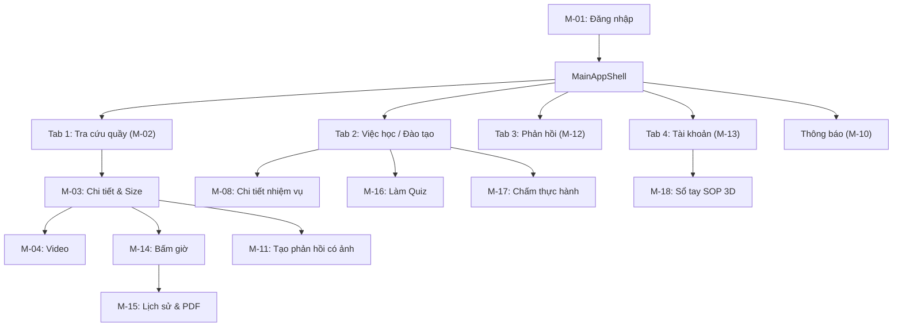
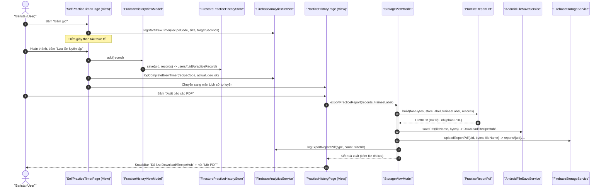
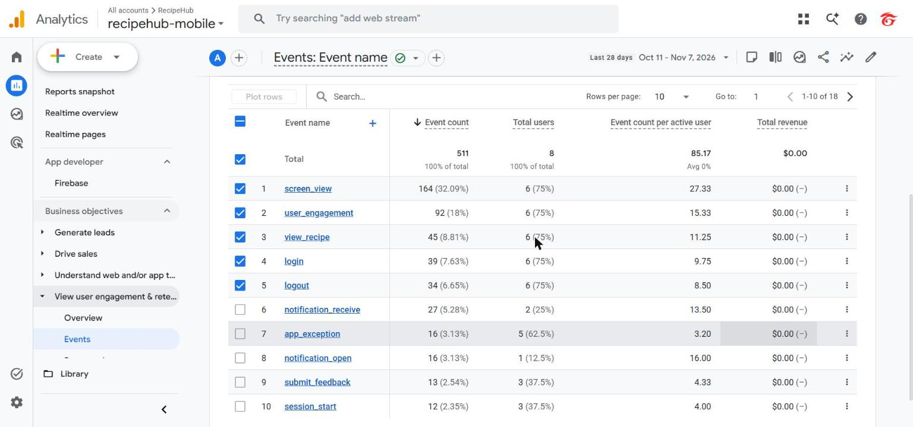

  

    
TRƯỜNG ĐẠI HỌC FPT • BỘ MÔN CÔNG NGHỆ THÔNG TIN

    
PRM393 – PHÁT TRIỂN ỨNG DỤNG DI ĐỘNG (MOBILE PROGRAMMING)

  

  

    <h1 class="cover-title">BÁO CÁO KỸ THUẬT LAB 3</h1>
    <h2 class="cover-subtitle no-break-top">XÂY DỰNG ỨNG DỤNG RECIPEHUB MOBILE VỚI NỀN TẢNG CLOUD FIREBASE VÀ KIẾN TRÚC MVVM</h2>
    

      PHIÊN BẢN PRODUCTION RELEASE
    

    

      
<strong>Học phần:</strong> Phát triển Ứng dụng Di động (PRM393)

      
<strong>Đề tài Lab 3:</strong> RecipeHub Mobile

      
<strong>Sinh viên thực hiện:</strong> Sinh viên: SE183201

      
<strong>Nền tảng kiểm thử vật lý:</strong> Xiaomi Redmi 7 (Android 10 - API 29)

      
<strong>Thời gian thực hiện:</strong> 04/11/2026 – 08/11/2026

    

  

  

    
Hồ Chí Minh, Khóa K18 – Năm 2026

  

## 1. Tổng quan Dự án & Tóm tắt Đặc tả Lab 2

### 1.1. Bối cảnh và Bài toán Nghiệp vụ
Trong chuỗi F&B (trà sữa, cà phê), duy trì tính nhất quán chất lượng đồ uống giữa các chi nhánh là thách thức cốt lõi:
- **SOP phân mảnh:** Công thức in giấy hoặc file PDF rải rác trên Zalo/nhóm chat dễ bẩn, khó cập nhật kịp thời khi R&D đổi công thức.
- **Áp lực quầy cao điểm:** Barista cần tra cứu định lượng theo size (S, M, L) tức thì trong 5–10 giây bằng một tay trên di động.
- **Đào tạo thiếu số liệu:** Quản lý (Store Admin) khó theo dõi ai đã đọc SOP, chưa làm Quiz; chấm thực hành bằng giấy dễ thất lạc.

**RecipeHub Mobile** số hóa toàn diện nghiệp vụ cho 2 vai trò: **Barista (Viewer)** và **Quản lý cửa hàng (Store Admin)**, kết nối Google Firebase với bộ dữ liệu Phê La chuẩn hóa (61 công thức theo size, 25 quy trình SOP).

### 1.2. Chân dung Người dùng (Persona)
Theo `docs/lab2/ux/persona.md`, hệ thống phục vụ 2 chân dung chính:
- **Barista Quầy Bar (Viewer) – Nguyễn Hoàng Tuấn (23 tuổi, Landmark 81):** Dùng Android 360–412 dp, thao tác một tay (tay ướt/đeo găng). Cần tra cứu không dấu tức thì, xem định lượng S/M/L, video kỹ thuật, đọc SOP, làm Quiz, bấm giờ tự luyện ($\pm 5$s), gửi phản hồi kèm ảnh ($< 5$ MB). *Điểm đau:* Công thức phân tán, khó biết bản mới nhất, thiếu thông báo nhắc nhở.
- **Quản lý Cửa hàng (Admin) – Quản lý / Trưởng ca:** Dùng Android và Web Admin. Cần giám sát tiến độ học tập toàn chi nhánh, lọc nhân viên quá hạn/cần học lại, chấm điểm thực hành tại quầy theo checklist, tiếp nhận phản hồi hiện trường, nhận cảnh báo sự cố real-time. *Điểm đau:* Thiếu số liệu tổng hợp, chấm giấy thủ công khó đối soát.

### 1.3. Các Luồng Nghiệp vụ Trọng yếu (User Flows từ Lab 2)
Khung điều hướng `MainAppShell` phân phối 4 tab chính và khay thông báo:

- **Flow 1 – Tra cứu tại quầy:** Đăng nhập → M-02 nạp từ Firestore → Tìm không dấu real-time → M-03 đổi Size S/M/L hiển thị định lượng tức thì → M-04 xem video từng bước.
- **Flow 2 – Tự luyện & Báo cáo:** M-03/FAB → Bấm giờ M-14 (dung sai chuẩn $\pm 5$s) → Lưu Firestore `users/{uid}/practiceRecords` → M-15 Lịch sử → Xuất PDF Unicode lưu máy `Download/RecipeHub` và đồng bộ Cloud Storage `reports/{uid}/`.
- **Flow 3 – Phản hồi hiện trường:** Barista tạo phản hồi M-11 (chọn ảnh $< 5$ MB) → Upload Storage & Firestore → Admin nhận real-time trên M-12 → M-12b xem ảnh, trả lời trao đổi và đổi trạng thái xử lý.

### 1.4. Tiêu chí Thành công Kỹ thuật (Success Criteria)
1. **Tốc độ tra cứu:** Tìm và hiển thị bảng định lượng size bất kỳ $\le$ **10 giây**.
2. **Minh bạch tiến độ:** 100% nhiệm vụ hiển thị chuẩn trạng thái: *Đang học*, *Quá hạn*, *Cần học lại*, *Hoàn thành*.
3. **Phân tầng đánh giá 3 lớp (Quy tắc BR-01):** Tách bạch: Đọc SOP/video (Lý thuyết cơ bản) $\rightarrow$ Quiz trắc nghiệm (Lý thuyết nâng cao) $\rightarrow$ Chấm quan sát thực hành tại quầy.
4. **Công thái học di động:** Vùng chạm cảm ứng $\ge$ **48 dp**, chiều cao nút chính $\ge$ **52 dp**, cỡ chữ nội dung $\ge$ **14 sp**.

---

## 2. Truy vết Thiết kế → Mã nguồn & Phân tích Sai lệch

### 2.1. Ma trận Truy vết Thiết kế (Traceability Matrix)
Toàn bộ 18 màn hình (M-01 → M-18) cùng phân hệ Admin và Hệ thống đã được chuyển đổi hoàn chỉnh sang mô hình MVVM, xóa bỏ hoàn toàn `MockDataService` để kết nối trực tiếp với Cloud Firestore và Firebase Storage. Mỗi màn hình đều gắn kết chặt chẽ giữa View (`lib/features/*`), ViewModel (`lib/core/viewmodels/*`), Service Interface (`lib/core/services/interfaces/*`) và sự kiện Analytics (`login`, `logout`, `view_recipe`, `start_brew_timer`, `complete_brew_timer`, `submit_feedback`, `export_report_pdf`, `trigger_test_crash`).

> [!NOTE]
> Chi tiết ma trận truy vết toàn bộ 18 màn hình, tệp mã nguồn, ViewModel phụ trách, Service Interface và ca kiểm thử xác nhận được đặc tả đầy đủ tại [Ma trận Truy vết Thiết kế](../docs/design-traceability.md).

### 2.2. Bảng Phân tích Sai lệch so với Thiết kế Ban đầu (Design Deviations)
Qua kiểm thử trực tiếp trên Xiaomi Redmi 7 ngày **07–08/11/2026**, chủ dự án yêu cầu điều chỉnh 8 điểm so với bản mẫu Figma Lab 2 nhằm tối ưu thao tác tại quầy:

| # | Hạng mục | Bản Figma (Lab 2) | Triển khai Mã nguồn Thực tế | Lý do kỹ thuật & Nghiệp vụ |
| :-: | :--- | :--- | :--- | :--- |
| 1 | **Ẩn mã món trên UI** | Hiện mã kỹ thuật (`CF-CB-01`, `TS-OL-02`) trên thẻ và chi tiết | Ẩn hoàn toàn mã món khỏi UI; chỉ hiện tên món, nhóm món và quy cách | Nhân viên chỉ cần tên món. Mã món chỉ dùng nội bộ trên Firestore và tham số Analytics. |
| 2 | **Bỏ chip "Ban hành · version"** | Gắn chip xanh "Ban hành · v2.0" trên thẻ tra cứu | Loại bỏ chip khỏi thẻ tra cứu; chỉ giữ số bước chuẩn và thời gian | Tối giản diện tích thẻ trên màn hình 360dp; thông tin phiên bản đưa vào màn chi tiết. |
| 3 | **Bỏ khối chi nhánh tại Tài khoản** | Khối chọn / hiển thị chi nhánh hoạt động | Bỏ khối chi nhánh; chỉ giữ thông tin người dùng và vai trò | Hệ thống chưa có bảng dữ liệu chi nhánh độc lập (`stores`); không đưa mock data lên UI. |
| 4 | **SOP vào Sổ tay điện tử** | Nút dẫn sang Thư viện SOP trên màn Tra cứu | Tách thành "Sổ tay SOP" tại màn Tài khoản với lật trang 3D & xuất PDF | Màn Tra cứu tập trung 100% vào pha chế khẩn cấp; SOP là tài liệu đào tạo chuyên sâu. |
| 5 | **Phân quyền giao diện Admin** | Mọi tài khoản đều có tiến độ học và nút tự luyện | Kiểm tra `hasPersonalLearning` (`false` khi là Admin) để ẩn tự luyện & tiến độ cá nhân | Admin đóng vai trò giám sát, chấm điểm; ẩn tính năng cá nhân giúp tập trung quản lý chi nhánh. |
| 6 | **Tối giản nút thao tác phụ** | Nút AppBar có cả icon và văn bản dài | Chuyển thành icon tròn/vuông gọn có Semantics và Tooltip | Ngăn lỗi tràn ngang (overflow) trên máy màn hẹp; bảo đảm tiếp cận TalkBack. |
| 7 | **Bỏ khối quy tắc (BR) thô** | Khung chữ nhật in văn bản quy tắc BR tĩnh | Loại bỏ hoàn toàn khối chữ quy tắc thô khỏi UI | Khối tĩnh gây rối mắt; logic nghiệp vụ được ràng buộc trực tiếp bằng code trong ViewModel. |
| 8 | **Nguồn dữ liệu chính** | Gọi Gateway API YARP (.NET 8) qua HTTP REST | Dùng trực tiếp **Cloud Firestore (real-time)** với Security Rules | Server .NET chưa chạy cloud chính thức; đồ án cấm server local; Firestore đáp ứng real-time & bảo mật. |

---

## 3. Kiến trúc Phần mềm MVVM & Thiết kế Phân tầng

### 3.1. Phân tầng Trách nhiệm (Separation of Concerns)
Ứng dụng áp dụng **MVVM + Provider** và nguyên lý Đảo ngược Phụ thuộc (DIP):
- **Tầng Giao diện (View - `lib/features/*`):** Widget khai báo, lắng nghe ViewModel qua `context.watch<T>()` hoặc kích hoạt hàm qua `context.read<T>()`. Tuyệt đối **không import trực tiếp SDK Firebase**.
- **Tầng ViewModel (`lib/core/viewmodels/*`):** Kế thừa `ChangeNotifier`, điều phối logic giao diện, quản lý trạng thái đồng bộ (loading, ready, empty, error), giao tiếp qua Service Interface, gọi `notifyListeners()` khi cập nhật.
- **Tầng Service Interface (`lib/core/services/interfaces/*`):** Hợp đồng trừu tượng (`IAuthService`, `IRecipeSource`, `ITrainingRepository`, `IStorageService`, `IAnalyticsService`), tách biệt logic khỏi thư viện cụ thể.
- **Tầng Triển khai Dịch vụ (`lib/core/services/firebase/*`, `device/*`):** Hiện thực hóa bằng Firebase SDK chính thức hoặc Android native (`AndroidFileSaveService`).
- **Composition Root (`lib/core/di/app_services.dart`):** Tiêm phụ thuộc linh hoạt giữa môi trường production (`AppServices.firebase()`) và kiểm thử (`AppServices.mock()`).

> [!NOTE]
> Toàn bộ sơ đồ lớp chi tiết và bảng ma trận 12 ViewModel ↔ Dịch vụ được lưu trữ đầy đủ tại [Tài liệu Kiến trúc Phần mềm](../docs/architecture.md).

### 3.2. Luồng Tuần tự: Tự luyện Pha chế & Xuất Báo cáo PDF (Sequence Diagram)
Quy trình phối hợp đa tầng từ khi Barista bấm giờ, ghi Firestore, sinh file PDF tiếng Việt Unicode lưu máy và đồng bộ lên Firebase Storage:

---

## 4. Hệ thống Thiết kế NomadKit (Design System)

Hệ thống thiết kế **NomadKit** (`lib/core/theme/nomad_kit.dart`) tối ưu thị giác ấm áp, độ tương phản cao cho môi trường ánh sáng quầy bar:

### 4.1. Bảng Token Màu Sắc (Color Tokens)
| Token | Hex | Vai trò & Ứng dụng |
| :--- | :--- | :--- |
| `NomadKit.canvas` | `#FFFDF7` | Màu nền chủ đạo (nền kem nhẹ chống mỏi mắt) |
| `NomadKit.surface` | `#FFFFFF` | Nền thẻ Cards, bảng biểu, dialog nổi |
| `NomadKit.sand` | `#C49A6C` | Màu nhấn chính (Primary Accent): Logo, nút FAB, tab active |
| `NomadKit.sandDark` | `#A07040` | Nâu đậm: Nhãn mục, tiêu đề phần, nhấn giữ |
| `NomadKit.sandLight` | `#FAF6F0` | Nền thẻ nhấn nhẹ, phông nền lối tắt thao tác |
| `NomadKit.ink` | `#292524` | Chữ chính: Tương phản cao WCAG AAA trên nền kem |
| `NomadKit.secondary` | `#78716C` | Chữ phụ: Ghi chú, thời gian, đơn vị đo lường |
| `NomadKit.border` | `#E7E0D5` | Đường viền mảnh 1 dp phân tách các khối |
| `NomadKit.forest` / `forestLight` | `#166534` / `#DCFCE7` | Đạt, Đã ban hành, Hoàn thành nhiệm vụ |
| `NomadKit.ocean` / `oceanLight` | `#0891B2` / `#F0F9FF` | Hướng dẫn kỹ thuật, liên kết SOP |
| `NomadKit.warning` / `warningLight` | `#CA8A04` / `#FEF9C3` | Cảnh báo sắp hết hạn, bản ghi chép nháp |
| `NomadKit.error` | `#DC2626` | Lỗi hệ thống, nhiệm vụ quá hạn, Chưa đạt |

### 4.2. Kiểu Chữ và Quy tắc Công thái học (Typography & Ergonomics)
- **Kiểu chữ:** Sans-serif hệ thống (`Roboto` / `Noto Sans`); định lượng và mã số dùng monospace chống nhầm chữ số (`0`/`O`, `1`/`l`).
- **Phân cấp kích thước:** Nội dung thân bài **14–15 sp**; chỉ dẫn thao tác nhanh **18–22 sp** để đọc rõ từ khoảng cách 50–70 cm.
- **Quy tắc lề & bo góc:** Bội số của 4 dp (`4, 8, 12, 16, 24 dp`), lề ngang an toàn **16 dp**. Bo góc: `4 dp` (badge), `8 dp` (input), `14 dp` (card), `16 dp` (nút bấm/dialog), `999 dp` (pill chip).
- **Vùng chạm cảm ứng:** Chiều cao nút chính $\ge$ **52 dp**, vùng chạm tối thiểu $\ge$ **48 dp**, triệt tiêu bấm nhầm lúc cao điểm.

---

## 5. Tích hợp 7 Dịch vụ Firebase & Cơ chế Xử lý Ngoại lệ

Ứng dụng kết nối trực tiếp dự án Firebase production `recipehub-mobile` qua các Service Interface:

### 5.1. Firebase Authentication (`IAuthService` → `FirebaseAuthService`)
- **Phương thức:** Email/Mật khẩu (Admin cấp), Google Sign-In qua Account Picker hệ thống Android, Đăng nhập Khách (Anonymous). Phân quyền bằng custom claim `role` trong ID Token kết hợp đối soát `users/{uid}` trên Firestore.
- **Xử lý lỗi:** Mất mạng báo `AuthFailureCode.network` ("Không có kết nối mạng"); người dùng hủy chọn Google Sign-In báo `AuthFailureCode.cancelled` và giữ nguyên trạng thái, **chặn không gửi lên Crashlytics** (CR-09); tài khoản bị khóa (`disabled == true`) tự động đăng xuất tức thì (CR-10).
- **Minh chứng:** Ảnh chụp Console xác thực người dùng đã làm mờ tại `../evidence/lab3/06-firebase-console/...`.

### 5.2. Cloud Firestore (`FirestoreRecipeSource`, `FirestoreTrainingRepository`, ...)
- **Dữ liệu thật:** Xóa bỏ hoàn toàn `MockDataService`. Nạp trực tiếp 61 công thức Phê La theo size và 25 tài liệu SOP vào các collection: `recipes`, `sops`, `learningTasks`, `quizzes`, `evaluationCriteria`. Dùng luồng `snapshots()` đồng bộ real-time.
- **Security Rules (`firebase/firestore.rules`):** `users/{uid}` chỉ chính chủ/Admin đọc, client chỉ cập nhật `lastSeenAt`; `recipes`/`sops`/`learningTasks` chỉ Admin ghi; `quizzes` không chứa đáp án client (subcollection `answerKey` chỉ mở sau khi nộp bài `quizAttempts`); `feedback` Barista chỉ đọc/ghi của chính mình, Admin đọc toàn bộ; `incidents` mọi client ghi nhận lỗi, chỉ Admin cập nhật.
- **Minh chứng:** Ảnh chụp nạp dữ liệu thật tại `../evidence/lab3/02-seed-real-data/...`.

### 5.3. Cloud Storage (`IStorageService` → `FirebaseStorageService`)
- **Nghiệp vụ:** Lưu ảnh phản hồi tại `feedback/{uid}/{file}`, báo cáo PDF tại `reports/{uid}/{file}`, tài liệu SOP tại `sop/{file}`, stream video MP4 tại `recipe-videos/{code}/{file}`.
- **Security Rules:** Giới hạn $\le$ **5 MB** (ảnh, PDF) và $\le$ **100 MB** (video MP4); chỉ chấp nhận ảnh hợp lệ (`png`, `jpeg`, `jpg`, `webp`, `heic`) và `application/pdf`; **chặn tuyệt đối SVG** (chống XSS).
- **Xử lý lỗi:** Chặn file $> 5$ MB ngay tại client; tự động tạm dừng và tiếp tục upload khi có mạng trở lại.
- **Minh chứng:** Ảnh gửi phản hồi kèm ảnh tại `../evidence/lab3/01-feedback-realtime/...`.

### 5.4. Firebase Cloud Messaging (FCM - `INotificationService` → `FirebaseNotificationService`)
- **Cấu hình:** Lưu FCM Token vào `users/{uid}/devices/{token}` (`model: Redmi 7`, `osVersion: Android 10`). Tạo Notification Channel `recipehub_updates` mức ưu tiên cao (`IMPORTANCE_HIGH`) trên MIUI.
- **3 trạng thái ứng dụng:**
  - *Foreground:* Nhận tin tức thì, hiện SnackBar nổi (`SnackBarBehavior.floating`) kèm nút "Xem", bật chấm đỏ icon chuông AppBar.
  - *Background:* Hiện thông báo khay hệ thống Android (Notification Shade).
  - *Terminated:* Đánh thức tiến trình ngầm; chạm thông báo thực hiện khởi động lạnh và điều hướng chính xác vào chi tiết món/SOP (Deep Link).
- **Minh chứng:** Kết quả kiểm thử thủ công ngày 08/11/2026 với 5 ảnh tại `../evidence/lab3/06-firebase-console/...`.

### 5.5. Firebase Analytics (`IAnalyticsService` → `FirebaseAnalyticsService`)
- **Nguyên tắc an toàn (No PII):** Không thu thập email, họ tên, SĐT. `AnalyticsEvent.sanitize` tự động loại bỏ chuỗi chứa `@` hoặc $\ge 9$ chữ số liên tiếp. User properties: `user_role`, `auth_mode`, `store_code`.
- **Ghi nhận công cụ kiểm chứng:** Trên thiết bị thật Redmi 7, DebugView trên Console không hiện event thời gian thực dù logcat xác nhận cờ `_dbg` và HTTP 204 (tài liệu trước nhắc `01-analytics-debug-logcat.log`, nhưng file chưa có trong checkout; chưa thể đối soát log ở đây). Nhóm đối soát qua **Báo cáo Sự kiện GA4 (Events Report)** kết hợp lọc logcat `adb logcat -s FA-SVC`.
- **Minh chứng:** Bảng số liệu thực tế từ ảnh chụp `../evidence/lab3/06-firebase-console/01-analytics-events.jpg` (511 sự kiện, 8 người dùng).

### 5.6. Firebase Crashlytics (`ICrashReporter` → `FirebaseCrashReporter`)
- **Bắt lỗi toàn diện:** Phân biệt fatal crash (`PlatformDispatcher.instance.onError`) và non-fatal error (`FlutterError.onError` qua `recordFlutterError` tránh méo chỉ số crash-free). Lọc nhiễu CR-09 (chặn lỗi mạng `network` và hủy Google `cancelled`).
- **Phối hợp sự cố:** Khi gặp lỗi fatal hoặc bấm "Kiểm thử sự cố", app đồng thời ghi collection `incidents/` trên Firestore. Web Admin phát âm thanh cảnh báo và hiện banner đỏ trong vòng **1 giây**.
- **Minh chứng:** Ảnh chụp Crashlytics tại `../evidence/lab3/06-firebase-console/...`.

### 5.7. Firebase Remote Config (`IRemoteConfigService` → `FirebaseRemoteConfigService`)
- **Tham số:** `max_lookup_results` (mặc định: `50`), `enable_ai_assist` (`false`), `show_crash_demo` (`true`).
- **Cơ chế cập nhật:** `fetchAndActivate()` khi mở app và lắng nghe luồng `onConfigUpdated`. Thay đổi tham số trên Console phân phối đến app trong **30 giây đến 4 phút** không cần khởi động lại.
- **Minh chứng:** Ảnh chụp Remote Config tại `../evidence/lab3/06-firebase-console/...`.

---

## 6. Kế hoạch Đo lường Firebase Analytics & Báo cáo Số liệu Thực tế

### 6.1. Danh mục 8 Sự kiện Chuẩn trong Mã nguồn
| # | Tên Event (`snake_case`) | Điểm kích hoạt | Tham số đính kèm | Câu hỏi sản phẩm cần giải quyết | Luồng |
| :-: | :--- | :--- | :--- | :--- | :-: |
| 1 | `login` | `AuthViewModel._onSignedIn` | `method`, `user_role` | Tỷ lệ đăng nhập Google/Email/Khách? Số Admin mobile? | Flow 1 |
| 2 | `logout` | `AuthViewModel.signOut` | `user_role`, `session_minutes` | Thời lượng một ca tra cứu/luyện tập tại quầy? | Flow 3 |
| 3 | `view_recipe` | `RecipeDetailSizePage.initState` | `recipe_code`, `category`, `size`, `source` | Nhóm món tra cứu nhiều nhất? Tỷ lệ mở từ push FCM? | Flow 1 |
| 4 | `start_brew_timer` | `SelfPracticeTimerPage._toggleTimer` | `recipe_code`, `size`, `target_seconds` | Công thức nào được tự luyện bấm giờ nhiều nhất? | Flow 2 |
| 5 | `complete_brew_timer` | `SelfPracticeTimerPage._savePracticeRecord` | `recipe_code`, `size`, `actual_seconds`, `deviation_seconds`, `within_tolerance` | Barista thao tác kịp giờ chuẩn ($\pm 5$s) không? Món nào hay trễ? | Flow 2 |
| 6 | `submit_feedback` | `CreateFeedbackPage._submitFeedback` | `feedback_type`, `target_type`, `target_code`, `has_attachment` | Loại phản hồi chiếm đa số? Tỷ lệ kèm ảnh hiện trường? | Flow 3 |
| 7 | `export_report_pdf` | `StorageViewModel.exportPracticeReport` | `report_type`, `record_count`, `file_size_kb` | Tần suất xuất báo cáo PDF? Dung lượng tệp có tối ưu? | Flow 2 |
| 8 | `trigger_test_crash` | `AccountProfilePage._crashDemo` | `kind` (`fatal`, `non_fatal`) | Tính năng kiểm thử sự cố được kích hoạt bao nhiêu lần? | Test |

### 6.2. Báo cáo Số liệu Thực tế từ Google Analytics (Ảnh `01-analytics-events.jpg`)
Dữ liệu trích xuất trực tiếp từ Google Analytics (GA4) dự án `recipehub-mobile` (11/10/2026 – 07/11/2026), minh chứng bằng tệp ảnh `../evidence/lab3/06-firebase-console/01-analytics-events.jpg`:

Hình 1: Thống kê sự kiện thực tế trên Google Analytics Console (Minh chứng: 01-analytics-events.jpg)

| STT | Tên sự kiện (Event Name) | Số lượng (Count) | Tỷ lệ (%) | Người dùng (Users) | Sự kiện / User |
| :-: | :--- | :-: | :-: | :-: | :-: |
| 1 | `screen_view` | 164 | 32.09% | 6 (75%) | 27.33 |
| 2 | `user_engagement` | 92 | 18.00% | 6 (75%) | 15.33 |
| 3 | `view_recipe` | 45 | 8.81% | 6 (75%) | 11.25 |
| 4 | `login` | 39 | 7.63% | 6 (75%) | 9.75 |
| 5 | `logout` | 34 | 6.65% | 6 (75%) | 8.50 |
| 6 | `notification_receive` | 27 | 5.28% | 2 (25%) | 13.50 |
| 7 | `app_exception` | 16 | 3.13% | 5 (62.5%) | 3.20 |
| 8 | `notification_open` | 16 | 3.13% | 1 (12.5%) | 16.00 |
| 9 | `submit_feedback` | 13 | 2.54% | 3 (37.5%) | 4.33 |
| 10 | `session_start` | 12 | 2.35% | 3 (37.5%) | 4.00 |
| **Tổng** | **Toàn bộ sự kiện** | **511** | **100%** | **8 Users** | **85.17 / User** |

#### Đọc số liệu (lưu ý phạm vi)
Số liệu trên là dữ liệu thật trên GA4 (28 ngày, đến 07/11/2026). Tuy nhiên chúng đến từ 8 tài khoản của nhóm phát triển và kiểm thử, không phải Barista tại cửa hàng. Vì vậy bảng chỉ xác nhận các tên event và số lượt đã xuất hiện trong kỳ thống kê, không dùng để kết luận về hành vi người dùng.

1. `view_recipe` (45 lượt), `submit_feedback` (13 lượt), `notification_receive` (27) / `notification_open` (16) là số lượt kiểm thử; không suy ra mức sử dụng tại quầy.
2. `app_exception` (16 lượt, 5 người) là dữ liệu kiểm thử; ảnh tổng hợp không đủ để đối chiếu từng event với từng lỗi Crashlytics.
3. Các câu hỏi sản phẩm trong `docs/analytics-plan.md` (ví dụ: món nào được tra nhiều nhất, tỷ lệ mở thông báo) sẽ chỉ trả lời được khi có người dùng thật.

---

## 7. Phân tích Chuyên sâu: Crashlytics & Remote Config

### 7.1. Quản lý Sự cố & Lọc Nhiễu với Firebase Crashlytics
1. **Phân tách Fatal Crash và Non-Fatal Error:** Lỗi chết app cấp isolate/nền tảng ghi nhận fatal crash. Lỗi giao diện Flutter (`RenderFlex overflowed`) chuyển thành non-fatal error qua `recordFlutterError`, không làm méo chỉ số crash-free users.
2. **Lọc ngoại lệ dự kiến (Issue CR-09):** Barista mất mạng khi đăng nhập hoặc bấm hủy hộp thoại Google Sign-In là tình huống bình thường có SnackBar. Hệ thống chặn không gửi mã `network` và `cancelled` lên Crashlytics, giữ bảng điều khiển sự cố luôn sạch và chính xác.
3. **Ngữ cảnh điều tra:** Đính kèm custom keys: `user_role`, `screen_name`, `device_model: Redmi 7`, `os_version: Android 10`.

### 7.2. Thử nghiệm Cấu hình Động với Firebase Remote Config
- **Thử nghiệm thực tế (Mã lỗi E-19):** Đổi tham số `max_lookup_results` từ `50` xuống `3` rồi tăng lại từ `3` lên `50` qua Firebase Console.
- **Phát hiện và xử lý lỗi 2 lớp:**
  - *Lớp dữ liệu:* Khi tăng giới hạn, ViewModel không tự kích hoạt truy vấn bổ sung $\rightarrow$ bổ sung `RecipeViewModel.applyLimit(newLimit)`.
  - *Lớp giao diện:* Màn hình tra cứu đọc bộ đệm tĩnh thay vì lắng nghe trạng thái $\rightarrow$ chuyển sang `context.watch<RecipeViewModel>()`.
- **Độ trễ phân tán:** Thử nghiệm trên Redmi 7 ghi nhận cập nhật phân phối đến app trong **30 giây đến 4 phút**.

---

## 8. Kế hoạch Kiểm thử Tự động E2E với ARTEMIS

### 8.1. Tổng quan Kế hoạch Kiểm thử Tự động
Bộ kiểm thử tự động toàn diện được thiết kế gồm **24 ca kiểm thử (TC-01 → TC-24)** bao phủ 11 luồng chức năng, phân quyền 2 vai trò (Barista/Admin), xử lý lỗi mạng, tương tác sâu Android gốc (Photo Picker, Notification Shade, Google Sign-In) và kiểm chứng đo lường Analytics/Remote Config trên thiết bị Xiaomi Redmi 7 (Android 10 - API 29).

> [!NOTE]
> Danh mục đầy đủ 24 ca kiểm thử chi tiết (TC-01 → TC-24), hướng dẫn instruction cho agent, kết quả mong đợi và tệp mã kiểm thử tương ứng được đặc tả chi tiết tại [Kế hoạch Kiểm thử ARTEMIS](../docs/test-plan.md).

### 8.2. Ghi nhận Thực tế: Kiểm thử Thủ công FCM trên Redmi 7 (Ngày 08/11/2026)
Trong đợt thử nghiệm ngày 08/11/2026, nhóm phát triển gửi push notification trực tiếp từ Firebase Console Messaging đến FCM Token của thiết bị vật lý Redmi 7:
1. **Kết quả 3 trạng thái:** *Foreground* hiển thị SnackBar nổi kèm nút "Xem" và bật chấm đỏ chuông AppBar; *Background* hiển thị trên khay thông báo Android với đầy đủ âm báo; *Terminated* đánh thức tiến trình ngầm, chạm thông báo khởi động lạnh và điều hướng chính xác vào màn hình Thông báo (`NotificationsPage`).
2. **Khắc phục 2 lỗi phát hiện trên Android 10:**
   - *Trùng SnackBar khi mở từ khay (CR-11):* Màn hình đã chuyển đến thông báo nhưng trong app vẫn bật thêm SnackBar $\rightarrow$ bổ sung cờ `isOpenedFromTray = true` để bỏ qua banner nội bộ.
   - *Hộp thoại xin quyền thừa (CR-10):* Android 10 cấp quyền thông báo mặc định khi cài đặt nhưng app vẫn hiện dialog xin quyền $\rightarrow$ dùng `device_info_plus` chỉ bật dialog trên Android 13+ (API 33+).
3. **Minh chứng:** Ảnh chụp màn hình kiểm chứng lưu trữ tại `../evidence/lab3/06-firebase-console/`.

---

## 9. Đánh giá Mã nguồn (Code Review) & Quản lý Thay đổi

Theo tài liệu đánh giá mã nguồn `docs/code-review.md`, đội ngũ đã thực hiện rà soát toàn diện và ghi nhận **17 phát hiện**: **13 phát hiện đã sửa triệt để (CR-01 → CR-13)** và **4 phát hiện hoãn sang Final Assignment (CR-14 → CR-17)**:

### 9.1. Danh sách 13 Phát hiện Đã Sửa Triệt để (CR-01 → CR-13)
| Mã | Mức độ | Tệp mã nguồn | Phát hiện rủi ro & Giải pháp kỹ thuật | Commit kiểm chứng |
| :---: | :---: | :--- | :--- | :--- |
| **CR-01** | Cao | `core/viewmodels/training_viewmodel.dart` | Trạng thái Admin không dọn dẹp khi đăng xuất $\rightarrow$ thêm `reset()` giải phóng listener. | `fix(mobile): CR-01 reset admin training state` |
| **CR-02** | Vừa | `core/services/firebase/firestore_training_repository.dart` | Stream tiến độ nhân viên bị ngắt khi đổi màn $\rightarrow$ cấu hình `StreamController.broadcast()`. | `fix(mobile): CR-02 keep admin staff progress live` |
| **CR-03** | Cao | `core/viewmodels/recipe_viewmodel.dart` | Tìm kiếm chỉ lọc theo từ đầu $\rightarrow$ chuẩn hóa `removeDiacritics` và lọc giao thoa mảng từ. | `fix(mobile): CR-03 filter remote search results` |
| **CR-04** | Cao | `features/lookup/counter_recipe_lookup_page.dart` | Món được giao ngoài `max_lookup_results` lỗi deep link $\rightarrow$ bổ sung `findForDeepLink`. | `fix(mobile): CR-04 open assigned recipes beyond limit` |
| **CR-05** | Thấp | `core/viewmodels/step_video_viewmodel.dart` | Thiết bị và tiêu chí bị hardcode $\rightarrow$ trích xuất trực tiếp từ Firestore `step.equipment`/`criteria`. | `fix(mobile): CR-05 derive step equipment and criteria` |
| **CR-06** | Vừa | `core/viewmodels/notification_viewmodel.dart` | Hàng đợi thông báo không giới hạn nguy cơ OOM $\rightarrow$ áp dụng Circular Buffer tối đa 50 mục. | `fix(mobile): CR-06 keep most recent notifications` |
| **CR-07** | Vừa | `features/feedback/create_feedback_page.dart` | Nội dung phản hồi không chặn 2000 ký tự $\rightarrow$ thêm `LengthLimitingTextInputFormatter(2000)`. | `fix(mobile): CR-07 limit feedback content 2000-char` |
| **CR-08** | Thấp | `features/lookup/step_video_guide_page.dart` | Mốc video hiển thị giây thô (`75s`) $\rightarrow$ định dạng chuẩn phút:giây `mm:ss` (`01:15`). | `fix(mobile): CR-08 format step video timestamp mm:ss` |
| **CR-09** | Vừa | `core/viewmodels/auth_viewmodel.dart` | Lỗi mạng / hủy Google Sign-In gửi lên Crashlytics $\rightarrow$ lọc bỏ mã `network` và `cancelled`. | `fix(mobile): CR-09 stop reporting routine sign-in failures` |
| **CR-10** | Thấp | `features/account/account_profile_page.dart` | Hộp thoại xin quyền thừa trên Android 10 $\rightarrow$ kiểm tra API, chỉ hiện dialog trên Android 13+. | `fix(mobile): CR-10 skip notification primer Android 10` |
| **CR-11** | Thấp | `core/viewmodels/notification_viewmodel.dart` | Mở push notification từ khay bị trùng SnackBar $\rightarrow$ gắn cờ `isOpenedFromTray = true`. | `fix(mobile): CR-11 do not repeat in-app banner` |
| **CR-12** | Thấp | `features/account/change_password_page.dart` | Tài khoản Google đổi mật khẩu lỗi khó hiểu $\rightarrow$ thông báo rõ: "Tài khoản Google không dùng mật khẩu.". | `fix(mobile): CR-12 neutral message no password` |
| **CR-13** | Cao | `core/viewmodels/training_viewmodel.dart` | Hoàn thành nhiệm vụ ghi đè nếu stream chưa xong $\rightarrow$ khóa nút ghi đến khi stream `ready`. | `fix(mobile): CR-13 block progress writes until ready` |

### 9.2. Danh sách 4 Phát hiện Hoãn sang Final Assignment (CR-14 → CR-17)
- **CR-14 (Quản lý đa chi nhánh độc lập):** Gán mã mặc định `CN-QUAN1` do chưa có bảng `stores`; cần thiết kế lại cấu trúc Firestore ở Final.
- **CR-15 (Hàng đợi đồng bộ Offline chuyên sâu):** Mất mạng kéo dài chỉ báo lỗi UI; cần xây dựng Local Sync Queue + Background Service ở Final.
- **CR-16 (Đồng bộ trạng thái đã đọc thông báo hai chiều):** Khi app bị kill, trạng thái đọc chỉ lưu máy; cần Cloud Functions đồng bộ ở Final.
- **CR-17 (Trình phát video thích ứng Adaptive Bitrate):** Đang stream trực tiếp file MP4; cần chuyển đổi sang HLS/DASH (m3u8) ở Final.

> [!NOTE]
> Báo cáo phân tích chuyên sâu toàn bộ 17 phát hiện rà soát mã nguồn được lưu trữ tại [Báo cáo Đánh giá Mã nguồn](../docs/code-review.md).

---

## 10. Khó khăn Gặp phải trong Quá trình Phát triển

1. **Màn hình nhỏ Redmi 7 (360 dp):** Bề rộng hẹp gây lỗi tràn ngang `RIGHT OVERFLOWED BY 9.5 PIXELS` tại hàng chip và thẻ món. *Khắc phục:* Bọc `Flexible`/`Expanded` kèm `TextOverflow.ellipsis`, chuyển nút chữ dài thành icon gọn gàng.
2. **Vòng đời widget & Bất đồng bộ:** Khi đăng xuất/đổi vai trò, `MainAppShell` tái tạo cây widget; các tác vụ async tiếp tục chạy gây `setState() called after dispose()` và `ConcurrentModificationError`. *Khắc phục:* Thêm `if (!mounted) return;` và sao chép danh sách `List.from`.
3. **Độ trễ phân tán Firestore & Remote Config:** Giá trị cấu hình đổi trên Console mất 30 giây đến 4 phút mới tới máy thật. *Khắc phục:* Nâng timeout kịch bản test lên 5–8 phút, ghi log sự kiện ngầm để phân biệt với lỗi app.
4. **Cơ chế quản lý ứng dụng của MIUI (Android 10):** Thông báo đẩy mặc định bị rơi vào nhóm Miscellaneous (im lặng); màn hình khóa PIN chặn chụp ảnh `adb screencap`. *Khắc phục:* Tạo channel `recipehub_updates` (`IMPORTANCE_HIGH`), cấu hình `svc power stayon usb`.

---

## 11. Bài học Kinh nghiệm

1. **Kiểm thử sớm trên thiết bị vật lý thật:** Máy ảo cấu hình cao thường che giấu lỗi hiệu năng, độ trễ và tràn viền giao diện. Đưa bản APK lên Redmi 7 ngay từ đầu giúp giải quyết sớm các lỗi thực tế.
2. **Sức mạnh của Kiến trúc MVVM và DIP:** Tách biệt View khỏi Data qua Service Interface cho phép chuyển đổi từ `MockDataService` sang Cloud Firestore mà **không sửa bất kỳ dòng mã nào trong View**, triệt tiêu rủi ro hồi quy.
3. **Đo lường sản phẩm dựa trên số liệu thực tế:** Thiết lập 8 sự kiện và đối soát tên/số lượt trên GA4 với dữ liệu kiểm thử; chưa có dữ liệu để kết luận hành vi sử dụng tại quầy.
4. **Code Review có kỷ luật:** 17 phát hiện giúp ngăn ngừa sớm rò rỉ bộ nhớ, bất đồng bộ và vi phạm Security Rules trước khi phát hành APK.

---

## 12. Công cụ Trí tuệ Nhân tạo (AI Tools Disclosure)

Minh bạch việc sử dụng công cụ AI theo quy định liêm chính học thuật:

| Công cụ AI | Mô hình nền tảng | Phạm vi nhiệm vụ cụ thể | Đánh giá hiệu quả thực tế |
| :--- | :--- | :--- | :--- |
| **Claude Code** | Claude Opus 5.5 | Lead Architect: Điều phối kiến trúc tổng thể, rà soát Code Review, thiết kế Security Rules Firestore/Storage, viết kịch bản E2E. | Khả năng suy luận ngữ cảnh lớn vượt trội, phát hiện chính xác lỗi bất đồng bộ và vòng đời widget. |
| **Claude Code** | Claude Sonnet 5.5 | Lập trình chi tiết UI Flutter, chuyển đổi token Figma sang `NomadKit`, chuẩn hóa bộ dữ liệu 61 công thức Phê La. | Tốc độ sinh mã nhanh, tuân thủ chặt chẽ cú pháp Flutter và design token. |
| **Codex CLI** | `gpt-6.1-sol` (Effort: Medium) | Logic xác thực Email/Mật khẩu; engine tạo báo cáo PDF tiếng Việt Unicode (`pdf: ^3.10.8`), dựng sổ tay SOP 133 trang, sửa layout tràn viền. | Xử lý xuất sắc thuật ngữ, mảng nhị phân PDF và bố cục in ấn. |
| **Antigravity CLI** | Gemini 3.8 Flash / Gemini 4 Argon | Phát triển Web Admin (`recipehub-mobile.web.app`), form nhập liệu công thức, script Python (`make_videos.py`) sinh video mô phỏng. | Xử lý ngữ cảnh đa phương tiện tốt, phối hợp nhịp nhàng giữa Flutter Web và Cloud Functions. |
| **CodeRabbit** | Hệ thống Agent Rà soát Tự động | Tự động phân tích PR trên GitHub, cảnh báo lỗ hổng bảo mật và vi phạm linter. | Duy trì mã nguồn sạch, đạt `0 issues` trong lệnh `flutter analyze`. |
| **ARTEMIS Agent** | Gemini Flash / Pro | Điều khiển thiết bị Android thật bằng ngôn ngữ tự nhiên để chạy kiểm thử E2E không xâm lấn. | Tự động hóa tương tác với Android OS (Photo Picker, Notification Shade). |

> [!IMPORTANT]
> **Phạm vi kiểm chứng:** Ảnh Firebase/FCM trong `evidence/lab3/06-firebase-console/` minh chứng các thao tác kiểm thử được mô tả. ARTEMIS mới chưa chạy (giữ TODO kết quả). Lượt follow-up offline chưa xác nhận lại Flutter analyze/test; xem `docs/coderabbit-followup.md`. Không suy rộng thành mọi thay đổi đã kiểm trên thiết bị.
